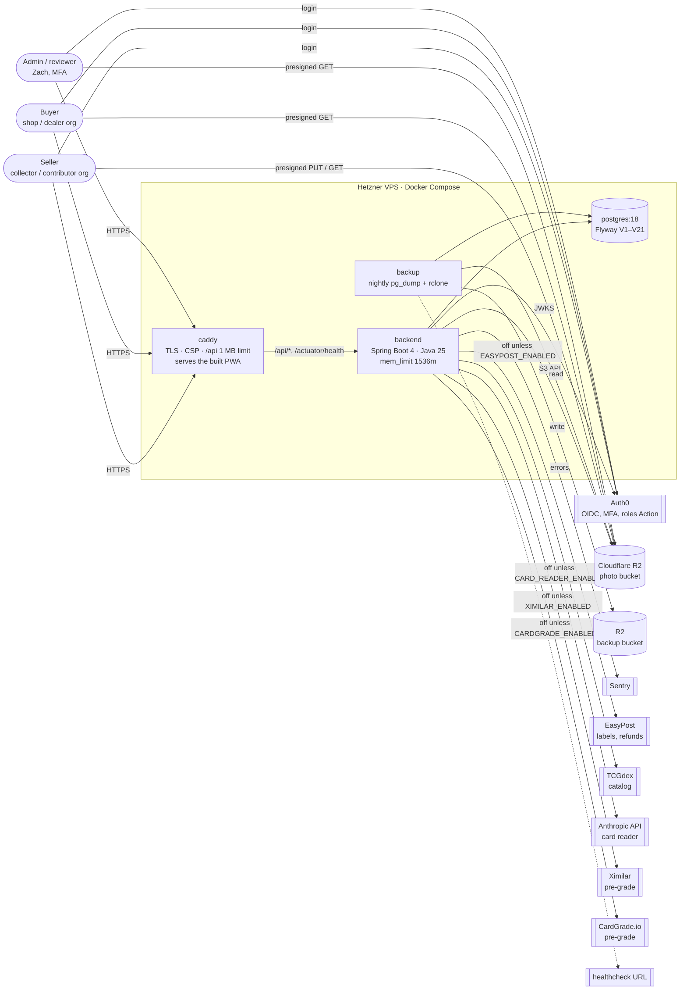

# System context and deployment

What runs where on `beta.rawmark.app`, and every outside system the code talks to. Drawn from `deploy/compose.prod.yml`, `deploy/Caddyfile` and the adapter classes, as of 2026-11-02.

## Context

## Notes

- **Only Caddy publishes ports** (80, 443, 443/udp). Caddy proxies `/api/*` and `/actuator/health` to `backend:8080`, answers 404 for the rest of `/actuator`, and serves the PWA from `/srv` (the `caddy` image is built from `web/`).
- **Photos never pass through the API.** The backend signs 15-minute URLs; the browser uploads to and reads from R2 directly. The backend reads originals back from R2 to run the photo checks, the card crop and the centering measurer.
- **Comps have no live source.** `pricing.PriceSource` has no production adapter: comps are entered by hand (`PricingController`) and the nightly `PricingScheduler` ingests from no source unless `PRICING_INGESTION_ENABLED` is set. Poketrace is a pilot in `analysis/`, not wired in ([poketrace-pilot.md](../poketrace-pilot.md)).
- **Optional adapters are off on prod by default** (`compose.prod.yml` env defaults): card reader, EasyPost, Ximilar, CardGrade.io and our own centering measurer (`CENTERING_ENABLED`).
- **No email.** There is no notifier; contact between buyer and seller is the email from the Auth0 token, shown on a deal.
- **One flat Docker network.** All four containers share the default Compose network; Postgres isn't published but is reachable from Caddy and the backup container.
- **TLS** is Caddy's automatic Let's Encrypt. Uptime is checked from outside on `/actuator/health`; the backup job pings a healthchecks URL when it finishes.
- **Deploys are manual.** `deploy/deploy.sh` on the server: `git pull`, a backup, `docker compose build` on the box (no `--pull`, no image tags), `up -d`. CI builds and tests but doesn't publish images. The Caddyfile is bind-mounted as a single file, so a Caddyfile-only change may not reach the running container ([review finding 2](../review-architecture-2026-11.md#fix-now-cheap-and-worth-it)).

## Differences from `docs/hld.md`

| HLD says | Code does |
|---|---|
| "One container (Spring Boot serving the built SPA) on a managed platform, plus managed Postgres" (§8) | Four containers on one self-managed VPS: Caddy serves the SPA, Postgres is a container, backups are our own job |
| JobRunr for scheduled jobs and retries (§3, §4.3) | `@Scheduled` pollers in `catalog`, `condition` and `pricing`; JobRunr isn't a dependency |
| `Notifier` adapter for email (§2) | Doesn't exist |
| Postgres row-level security as a second line of tenancy defence (§6) | No RLS; tenancy is enforced in the app only |
| `PriceDataProvider` for licensed price data | Named `PriceSource`, with no production implementation |
