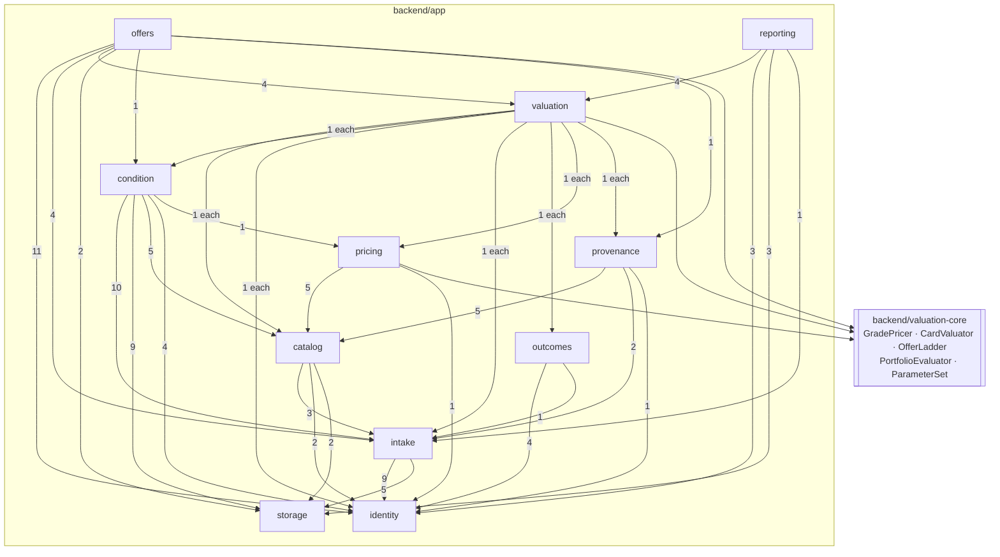
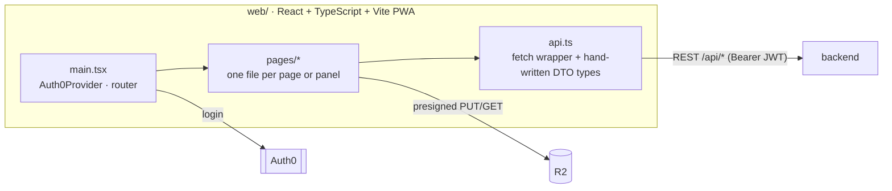

# Backend modules and web app

The Spring Boot app is a modular monolith under `com.pokemans.app`, one package per module, checked by Spring Modulith (`ModularityTest`: no cycles). `valuation-core` is a separate Gradle module with no Spring and no I/O. Drawn from the actual `import` statements, as of 2026-11-02.

## Backend module dependencies

An arrow means "imports from". The number is how many files in the source module import the target.

`identity` and `storage` depend on nothing. Most types are package-private: `offers` and `reporting` export nothing, `condition`, `pricing`, `provenance` and `outcomes` one type each (their published API). `identity` exports the most (14 public types), since every module needs the current user, org access and consents.

## What each module owns

| Module | Owns | Published API | Tables |
|---|---|---|---|
| `identity` | Orgs, members, invites, roles, terms acceptances, contact directory | `CurrentUser`, `OrgAccess`, `Consents`, `Directory` | `org`, `app_user`, `membership`, `invite`, `consent_record` |
| `storage` | Presigned URLs, blob reads | `BlobStore` (`S3BlobStore`) | — |
| `intake` | Collections, cards, photos, photo checks, card detection and crop | `CardItems` and its events | `collection`, `submission_batch`, `card_item`, `photo` |
| `catalog` | TCGdex catalog, identification, card reader queue | `Catalog` | `catalog_card`, `card_identification`, `card_reading` |
| `condition` | Provider predictions, centering, assessments (distributions), review queue, centering labels | `Assessments` | `prediction_request`, `provider_prediction`, `condition_assessment`, `centering_label` |
| `provenance` | Authenticity findings, custody | `Provenance` | `authenticity_verification`, `authenticity_verification_photo`, `custody_record` |
| `pricing` | Comps, per-grade price snapshots, σ and sales rate | `Prices` | `sold_comp`, `price_snapshot`, `price_stats`, `comp_ingest_run` |
| `outcomes` | Returned grades and their verification | `Outcomes` | `grade_outcome`, `outcome_verification` |
| `valuation` | Valuation runs; one card valued as of now for offers | `Valuations` | `valuation_run`, `card_valuation` |
| `reporting` | Lender and insurer PDFs (paused behind `pokemans.collateral.enabled`) | — | `report` |
| `offers` | Offers, listings, deals, labels, after-the-sale events, undo, track record | — | `card_offer`, `sale_listing`, `listing_event`, `shipping_label`, `ship_address`, `card_offer_void`, `label_refund` |

The ER diagram ([03-data-model.md](03-data-model.md)) has the exact tables.

## Async work

There is no job framework. Three modules poll with `@Scheduled`:

| Scheduler | What it does | Default |
|---|---|---|
| `catalog.RecognitionScheduler` | Works the `card_reading` queue (Claude card reader), and sweeps stuck rows | every 15 s; sweep 5 min |
| `condition.PredictionScheduler` | Works the provider prediction queue (Ximilar, CardGrade.io, centering), and sweeps | every 15 s; sweep 5 min |
| `pricing.PricingScheduler` | Ingests comps from every `PriceSource` and snapshots prices | 06:30 UTC, only with ingestion enabled |

Each queue is also kicked straight after commit by a `@TransactionalEventListener`, so the poll is the retry path. Offer and listing expiry isn't a job: status is computed from `expires_at` when read.

## Web app

Areas: seller (collections, card page with the offer panel, needs-you home), buyer (market, deals, ship-to address), admin (review queue, review card, prices, offers and deals, labels, shipping charges, track record, orgs, centering labels, valuation runs when collateral is on). Admin screens are hidden client-side by role; the backend enforces it on `/api/admin/**`.
