# Data model

The schema after Flyway V21 (`backend/app/src/main/resources/db/migration/`): 35 tables and one view, all `uuid` primary keys, `timestamptz` times, `numeric` money. Hibernate runs with `ddl-auto: validate`, so the migrations are the truth. As of 2026-11-02.

To keep it readable, the diagram leaves out the `org_id` copied onto most child rows and the `created_by` / `verified_by` style links to `app_user`. Dotted lines are logical references with no foreign key.

```mermaid
erDiagram
  org { uuid id PK  text type "PARTNER|COLLECTOR|CONTRIBUTOR|BUYER" }
  app_user { uuid id PK  text subject UK  text email }
  membership { uuid id PK  uuid org_id FK  uuid user_id FK  text role  timestamptz ended_at }
  invite { uuid id PK  uuid org_id FK  text role  text token_hash UK  timestamptz expires_at  timestamptz revoked_at }
  consent_record { uuid id PK  uuid org_id FK  uuid user_id FK  text terms_version  text terms_sha256 }
  submission_batch { uuid id PK  uuid org_id FK }
  collection { uuid id PK  uuid org_id FK  text name }
  card_item { uuid id PK  uuid org_id FK  uuid batch_id FK  uuid collection_id FK  boolean is_lot }
  photo { uuid id PK  uuid card_item_id FK  text side  text status  text storage_key UK  text sha256 }
  catalog_card { uuid id PK  text identity_key UK  text edition  text variant  text authenticity_risk }
  card_reading { uuid id PK  uuid card_item_id FK  uuid photo_id FK  text status }
  card_identification { uuid id PK  uuid card_item_id FK  uuid catalog_card_id FK  uuid reading_id FK  text source  text status }
  prediction_request { uuid id PK  uuid card_item_id FK  text provider  text status }
  provider_prediction { uuid id PK  uuid request_id FK  text provider  jsonb raw }
  condition_assessment { uuid id PK  uuid card_item_id FK  int version  jsonb distribution  text confidence  boolean is_current }
  centering_label { uuid id PK  uuid card_item_id FK  uuid photo_id FK  text face }
  grade_outcome { uuid id PK  uuid card_item_id FK  text grader  text cert_number  numeric grade }
  outcome_verification { uuid id PK  uuid outcome_id FK  text status }
  authenticity_verification { uuid id PK  uuid card_item_id FK  uuid catalog_card_id FK  text status  text method }
  authenticity_verification_photo { uuid verification_id PK  uuid photo_id PK }
  custody_record { uuid id PK  uuid card_item_id FK  text holder_type  boolean verified }
  comp_ingest_run { uuid id PK  text source }
  sold_comp { uuid id PK  uuid catalog_card_id FK  uuid ingest_run_id FK  text grading_company  numeric grade  numeric price  date sold_on }
  price_snapshot { uuid id PK  uuid snapshot_set_id  uuid catalog_card_id FK  text grading_company  text grade  numeric price  text method }
  price_stats { uuid id PK  uuid snapshot_set_id UK  uuid catalog_card_id FK  numeric sigma  numeric sales_per_month }
  valuation_run { uuid id PK  uuid collection_id FK  jsonb parameter_set  numeric collateral_base }
  card_valuation { uuid id PK  uuid run_id FK  uuid card_item_id FK  uuid assessment_id FK  uuid snapshot_set_id  numeric fmv  numeric flv  text confidence }
  report { uuid id PK  uuid run_id FK  text type  numeric lender_alpha  text sha256 }
  card_offer { uuid id PK  uuid card_item_id FK  uuid catalog_card_id FK  uuid assessment_id FK  uuid snapshot_set_id  numeric price  text confidence  timestamptz expires_at }
  card_offer_void { uuid id PK  uuid offer_id FK  text reason }
  sale_listing { uuid id PK  uuid offer_id FK  uuid card_item_id FK  timestamptz expires_at }
  listing_event { uuid id PK  uuid listing_id FK  text type  uuid actor_org_id FK  numeric price_paid }
  ship_address { uuid id PK  uuid org_id FK  text payment_method }
  shipping_label { uuid id PK  uuid listing_id FK  uuid buyer_org_id FK  uuid from_address_id FK  uuid to_address_id FK  numeric insured_value }
  label_refund { uuid id PK  uuid label_id FK  uuid listing_id FK  text provider_status }

  org ||--o{ membership : has
  app_user ||--o{ membership : holds
  org ||--o{ invite : issues
  org ||--o{ consent_record : records
  org ||--o{ submission_batch : owns
  org ||--o{ collection : owns
  submission_batch |o--o{ card_item : contains
  collection |o--o{ card_item : contains
  card_item ||--o{ photo : has
  card_item ||--o{ card_reading : read
  photo ||--o{ card_reading : "read from"
  card_item ||--o{ card_identification : "identified as"
  catalog_card ||--o{ card_identification : matches
  card_reading |o--o{ card_identification : suggests
  card_item ||--o{ prediction_request : queues
  prediction_request ||--o{ provider_prediction : answers
  card_item ||--o{ condition_assessment : versions
  card_item ||--o{ centering_label : labelled
  photo ||--o{ centering_label : "drawn on"
  card_item ||--o{ grade_outcome : graded
  grade_outcome ||--o{ outcome_verification : checks
  card_item ||--o{ authenticity_verification : findings
  catalog_card ||--o{ authenticity_verification : "checked as"
  authenticity_verification ||--o{ authenticity_verification_photo : uses
  photo ||--o{ authenticity_verification_photo : "used by"
  card_item ||--o{ custody_record : custody
  catalog_card ||--o{ sold_comp : sold
  comp_ingest_run |o--o{ sold_comp : ingested
  catalog_card ||--o{ price_snapshot : priced
  catalog_card ||--o{ price_stats : stats
  price_stats |o..|{ price_snapshot : "snapshot_set_id"
  collection ||--o{ valuation_run : valued
  valuation_run ||--o{ card_valuation : produces
  card_item ||--o{ card_valuation : "valued in"
  condition_assessment |o--o{ card_valuation : input
  price_snapshot }|..o{ card_valuation : "snapshot_set_id"
  valuation_run ||--o{ report : renders
  card_item ||--o{ card_offer : quoted
  condition_assessment |o--o{ card_offer : input
  price_snapshot }|..o{ card_offer : "snapshot_set_id"
  card_offer ||--o| card_offer_void : voided
  card_offer ||--o{ sale_listing : posted
  sale_listing ||--o{ listing_event : events
  org |o--o{ listing_event : actor
  sale_listing ||--o| shipping_label : label
  org ||--o{ ship_address : "ships from/to"
  ship_address ||--o{ shipping_label : "from / to"
  org ||--o{ shipping_label : "billed buyer"
  shipping_label ||--o{ label_refund : refunds
```

## Tables by module

| Module | Tables |
|---|---|
| identity | `org`, `app_user`, `membership`, `invite`, `consent_record` |
| intake | `submission_batch`, `collection`, `card_item`, `photo` |
| catalog | `catalog_card`, `card_reading`, `card_identification` |
| condition | `prediction_request`, `provider_prediction`, `condition_assessment`, `centering_label` |
| outcomes | `grade_outcome`, `outcome_verification` |
| provenance | `authenticity_verification`, `authenticity_verification_photo`, `custody_record` |
| pricing | `comp_ingest_run`, `sold_comp`, `price_snapshot`, `price_stats` |
| valuation | `valuation_run`, `card_valuation` |
| reporting | `report` |
| offers | `card_offer`, `card_offer_void`, `sale_listing`, `listing_event`, `ship_address`, `shipping_label`, `label_refund`; view `v_offer_outcomes` (read by `TrackRecordService`) |

## Conventions

- **Append-only.** A `refuse_update()` trigger blocks updates on 21 tables. Undo is a new row: `card_offer_void`, VOIDED / CANCELLED / RESOLVED `listing_event`s, `label_refund`, `membership.ended_at` with who and why. Not covered: `centering_label`, `condition_assessment` (only `is_current` should change), `card_reading`, `photo` (its status and metrics are updated by the photo check; the stored image is what's immutable).
- **Current = latest row.** A card's identity is its latest CONFIRMED `card_identification`; its condition is the `condition_assessment` with `is_current` (partial unique index).
- **No status columns for listings.** Status is derived from `listing_event` rows and `expires_at` ([04-flows.md](04-flows.md#4-listing-and-deal-state)). Partial unique indexes make "closed once" and "outcome once" hold under races; "one live listing per card" relies on a per-card advisory lock.
- **Price sets.** A refresh writes 11 `price_snapshot` rows per card and grader sharing a `snapshot_set_id`, plus one `price_stats` row. Valuations and offers point at the set with no FK, since comps can be purged for licence reasons and runs store their inputs anyway.
- **Parameter sets** are versioned files on the classpath, not a table. Runs keep the full body as jsonb; offers and snapshots keep the version string.

## Differences from `docs/hld.md` §5

| HLD | Schema |
|---|---|
| `DATA_SHARING_AGREEMENT` | `consent_record` |
| `AUTH_FLAG` table | Derived: `catalog_card.authenticity_risk` plus `authenticity_verification` for the current identity |
| `GRADER_SUBMISSION` | None; `grade_outcome` hangs off `card_item` |
| `PARAMETER_SET` table, step-down ratio tables | Classpath files; era ratios computed on the fly |
| `CARD_ITEM }o--|| CATALOG_CARD` | Many `card_identification` rows per card |
| `ORG ||--o{ USER` | Many-to-many through `membership` |
| `VALUATION_RUN ||--o| REPORT` | One run, many reports |
| Photo training-consent flag; row-level security | Neither exists |
| Price method FLOOR | Removed in V9; CARD_STEP_DOWN and NO_SALES added |
| Not mentioned | `membership`, `invite`, `card_reading`, `prediction_request`, `outcome_verification`, `comp_ingest_run`, `authenticity_verification(_photo)`, all seven offers tables |
