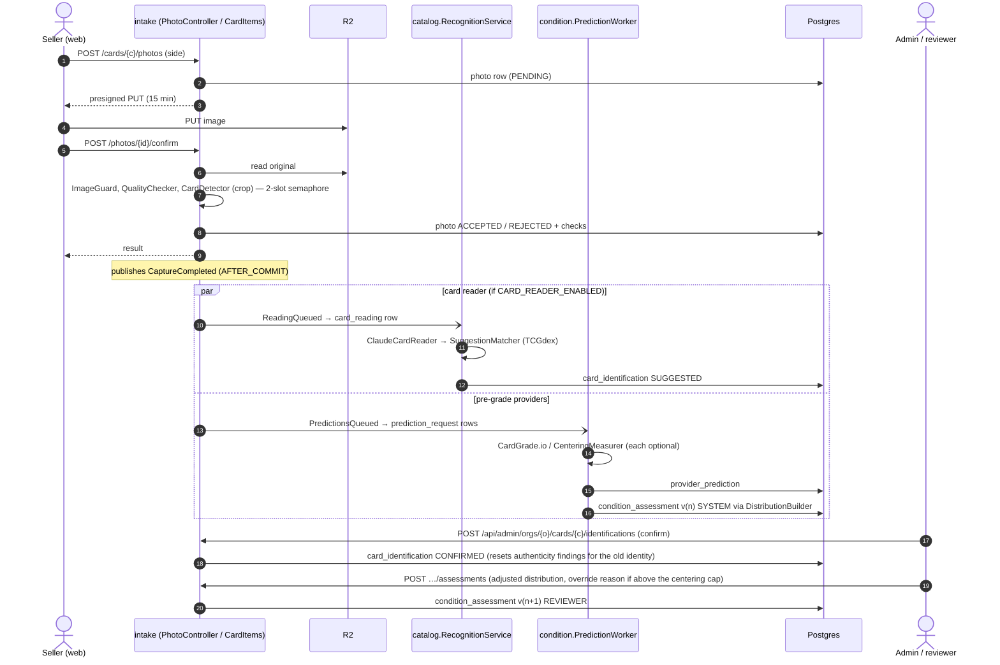

# Flows

The main paths through the system, as the code runs them on 2026-11-02. Class names are in `backend/app/src/main/java/com/pokemans/app/<module>/`. "Org" paths are under `/api/orgs/{orgId}`.

## 1. Photo → identification → condition distribution



Both queues are lease queues (`FOR UPDATE SKIP LOCKED`), polled every 15 s by `RecognitionScheduler` / `PredictionScheduler` and kicked straight after commit. A retake (`PhotoRetaken`) queues new predictions; `ListingCaptureFreeze` refuses a retake while the card is OPEN or ACCEPTED.

**Differences from the HLD:** events are `CaptureCompleted`, `PhotoRetaken`, `PredictionsQueued`, `ReadingQueued`, `TermsAccepted`, not `PhotosAccepted` / `CardIdentified` / `AssessmentFinalized` / `GradeReturned`. The centering decode runs on the worker executor outside the 2-slot photo semaphore (review finding [6](../review-architecture-2026-11.md#fix-now-cheap-and-worth-it)).

## 2. Valuation run (collateral, paused behind `pokemans.collateral.enabled`)

```mermaid
sequenceDiagram
  autonumber
  actor A as Admin
  participant VC as valuation.ValuationController
  participant VS as valuation.ValuationService
  participant In as catalog · condition · pricing · provenance · outcomes
  participant Core as valuation-core
  participant DB as Postgres
  participant Rep as reporting.ReportService

  A->>VC: POST /api/admin/orgs/{o}/collections/{c}/valuation-runs (grading cost, α?)
  VC->>VS: run
  loop each card
    VS->>In: Catalog.current, Assessments.current, Prices (PSA table + σ + sales rate), Provenance, Outcomes
    VS->>Core: CardValuator (GradePricer per grade → FMV, RV, QSV, FLV, confidence)
  end
  VS->>Core: PortfolioEvaluator (eligibility, 20% / top-5 50% caps, >40% slice haircut) + GradeFirstRanker
  VS->>DB: valuation_run + card_valuation (inputs + full trace)
  VC-->>A: run id
  A->>Rep: POST /api/admin/valuation-runs/{id}/reports (LENDER / INSURER)
  Rep->>DB: report row; PDF rendered from the run alone → R2
  Note over Rep: org members download via /api/orgs/{o}/reports/{id}/download
```

The same `Valuations.current(cardId)` path values one card "as of now" for offers (flow 3), without storing a run.

## 3. Offer → sell → accept → label → shipped → arrived → paid

```mermaid
sequenceDiagram
  autonumber
  actor S as Seller org
  actor B as Buyer org
  participant OC as offers.OfferController
  participant OS as OfferService
  participant LS as ListingService
  participant Sh as Shipping
  participant EP as EasyPost
  participant DB as Postgres

  S->>OC: POST /cards/{c}/offers
  OC->>OS: quote → Valuations.current → OfferLadder (margin by offer confidence)
  OS->>DB: card_offer (price, expires_at = +7 d)
  OC-->>S: firm price, or the reason there's none
  S->>OC: POST /cards/{c}/listings (offer id)
  OC->>LS: post (advisory lock per card)
  LS->>DB: sale_listing (expires_at = +14 d)

  B->>OC: GET /market
  B->>OC: POST /market/{listing}/accept
  OC->>LS: accept — lock, requireOpen, refuse if buyer shares a member with seller
  LS->>DB: listing_event ACCEPTED (commit)
  OC->>LS: buyLabel (lock, transaction)
  LS->>Sh: buy
  Sh->>EP: GET shipment by listing ref (idempotency)
  Sh->>EP: POST /shipments, POST /shipments/{id}/buy (insured at price)
  Sh->>DB: shipping_label
  OC-->>B: deals (+ labelPending reason if the buy failed)

  S->>OC: POST /listings/{l}/shipped (needs a label; within 3 d)
  LS->>DB: listing_event SHIPPED
  B->>OC: POST /deals/{l}/received
  LS->>DB: listing_event RECEIVED
  B->>OC: POST /deals/{l}/paid  (or seller /payment-confirmed; within 7 d)
  LS->>DB: listing_event PAID
  opt not genuine / not the listed card / doesn't match photos
    B->>OC: POST /deals/{l}/returned (reason)
    S->>OC: POST /listings/{l}/card-back
  end
```

Retries: the buyer `POST /deals/{l}/label` or the admin `POST /api/admin/deals/{l}/label?buyerOrgId=` repeat `buyLabel`. Labels are billed to the buyer monthly from `GET /api/admin/shipping/charges?month=` (computed in the controller, review finding 30). Payment itself is off-platform. There is no notifier: each side sees its next step on its home page (`needs-you`).

The EasyPost calls run inside the DB transaction while the card's advisory lock is held (review finding 24). `Shipping.buy`'s javadoc says it runs in its own transaction; it doesn't (finding 8).

## 4. Listing and deal state

There is no status column. Status is computed from `sale_listing.expires_at` and the `listing_event` rows by `ListingService.status` / `progress`, and again in SQL by the `v_offer_outcomes` view, and in two more places that disagree on BACK (review finding 26).

```mermaid
stateDiagram-v2
  [*] --> OPEN: post (offer still valid)
  OPEN --> WITHDRAWN: seller withdraw
  OPEN --> EXPIRED: 14 d pass (computed, no job)
  OPEN --> VOIDED: admin void / doubt recorded
  OPEN --> ACCEPTED: buyer accept
  ACCEPTED --> CANCELLED: admin cancel (before arrival)
  state ACCEPTED {
    [*] --> SOLD
    SOLD --> SHIPPED: seller shipped (label needed, 3 d)
    SHIPPED --> ARRIVED: buyer or admin received
    ARRIVED --> PAID: buyer paid / seller confirmed (7 d)
    ARRIVED --> RETURNED: buyer/admin returned (reason)
  }
  ACCEPTED --> BACK: seller card-back after RETURNED
  WITHDRAWN --> [*]
  EXPIRED --> [*]
  VOIDED --> [*]
  CANCELLED --> [*]: card free for a new offer; label may be refunded
  BACK --> [*]: held from new offers until RESOLVED if NOT_GENUINE
```



A DISPUTED event is a flag, not a stage: the seller files it while waiting for payment, or against a RETURNED (with a note), and it puts the deal on the admin's attention list until a RESOLVED event. Precedence when several events exist: CANCELLED > BACK > ACCEPTED > WITHDRAWN > VOIDED > expiry. An offer is live until `expires_at` (7 d) unless a `card_offer_void` row exists (admin void, doubt, or a cancelled deal). Undo is append-only: `card_offer_void`, a CANCELLED event and `label_refund` are new rows with who, when and why.
