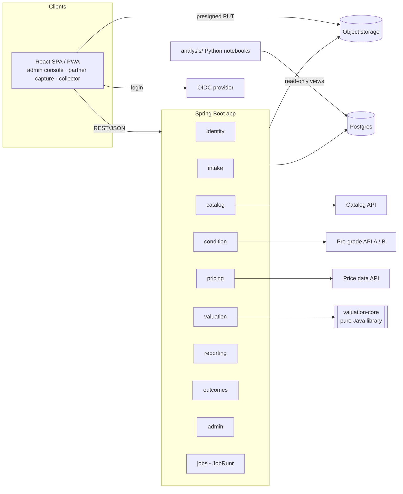
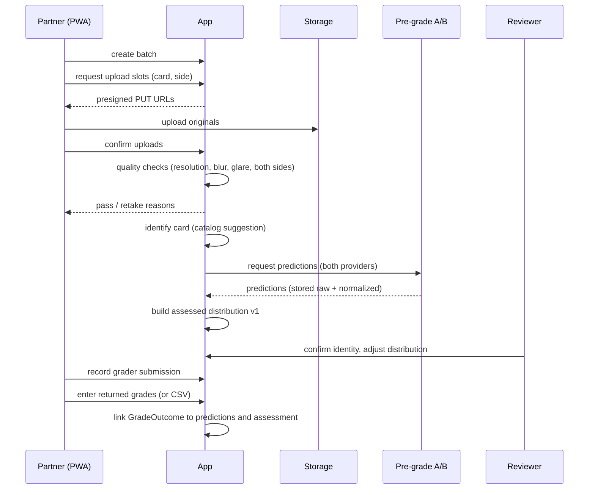
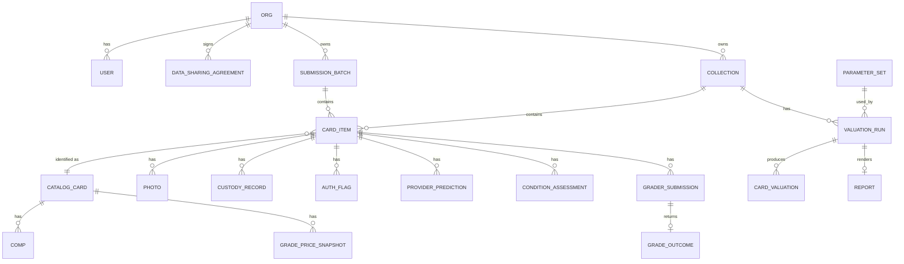

# High-level design: raw collection collateral reports

Status: draft v1 · 2026-10-16 · Zach
Shareable copy: [Raw Collection Collateral Reports: HLD](https://claude.ai/artifact/NH4ParzZyrmGe87Nh7m3Zy) (Claude Doc). This file is the source of truth; update the doc when this changes.

Related: [CLAUDE.md](../CLAUDE.md) (methodology summary) · [Valuation Methodology](https://claude.ai/artifact/1XVmPmLtueJk37u2hXgDmL) · [Leave Project Checklist](https://claude.ai/artifact/2CHCuUTTKJicxmLFNvD1qn)

## 1. Goals and non-goals

**Goal:** a system that turns photos of raw cards into a defensible collateral report (inventory, per-card grade distributions, FMV/RV/QSV/FLV with confidence, portfolio caps, collateral base, grade-first list), and that captures every prediction and its real grading outcome so the method can be calibrated.

v1 (through week 16) must:
- Let submission partners upload photos to a capture standard and later record returned grades.
- Let collectors upload their own collections and receive reports.
- Let the admin/reviewer (Zach) identify cards, review and adjust distributions, manage comps and parameters, and generate reports.
- Produce lender-ready and insurer-ready PDFs.
- Export prediction-vs-outcome and FLV-vs-later-price data for calibration.

Not in v1: a native mobile app, a custom photo model, lender/insurer portals, payments and billing, vault or custody integrations, automated authenticity verification.

## 2. Actors and external systems

| Actor | What they do |
|---|---|
| Admin / reviewer | Everything; works the review queues, owns parameter sets, issues reports |
| Partner user | Belongs to a partner org (shop, group-submission operator); uploads batches, records grader submissions and returned grades |
| Collector | Uploads their own collection, sees their cards and reports |
| Lender / insurer | No login in v1; receives PDF reports |

| External system | Role | Adapter |
|---|---|---|
| Card catalog (e.g. Pokémon TCG API) | Canonical card identities | `CatalogProvider` |
| Pre-grading APIs (two, compared) | Per-photo condition predictions | `PreGradeProvider` |
| Licensed price data | Sold comps per grade | `PriceDataProvider` |
| S3-compatible storage (R2/S3) | Photos, derivatives, report PDFs | `BlobStore` |
| OIDC provider (Auth0/Clerk-type) | Login, MFA | Spring Security resource server |
| Email (transactional) | Invites, report-ready notices | `Notifier` |

Every provider port has a **manual implementation** (the reviewer enters the identity, distribution or comps by hand), so the system never blocks on a vendor.

## 3. Architecture

A modular monolith: one Spring Boot app with enforced module boundaries (Spring Modulith, plus ArchUnit tests), one pure-Java valuation library, one React SPA, and a Python analysis workspace.



### 3.1 `valuation-core` (separate Gradle module)

No Spring, no I/O, `BigDecimal` throughout. Inputs are plain value objects; outputs carry an **explanation trace** (which comps, which rule, which parameter produced each number), which the report renders.

- `GradeDistribution`: 11 outcomes (U, 1–10), validation (sums to 1), `shiftDown(n)` with floor at 1 and U held, photo-confidence and surface adjustments (downward only).
- `GradePricer`: recency-weighted median (30-day half-life), 90 → 180-day window extension, outlier trim at n ≥ 10, missing-grade rule (log interpolation / step-down ratio / never step up), net-of-grading-cost with raw-price override, derived-price confidence drop.
- `CardValuator`: FMV, RV, QSV, FLV; confidence A–D.
- `PortfolioEvaluator`: eligibility, 20% single-card cap, 50% top-five cap, 40% set/character correlation haircut, raw/graded share, advance range for a lender-supplied α.
- `GradeFirstRanker`: lift per card, top 20 with lift > 1.0.
- `ParameterSet`: every constant from the methodology (f, b, s and d tiers, k, t, ℓ floor/cap, half-life, windows, caps, thresholds), loaded from versioned config.

The methodology's worked example (FMV $411 → RV $481 → QSV $314 → stressed FMV $181 → FLV $107 → advance $64) is the first golden test.

### 3.2 App modules

| Module | Owns |
|---|---|
| `identity` | Orgs, users, roles, invites, data-sharing agreements and training consent |
| `intake` | Collections, submission batches, card items, photos, photo quality checks |
| `provenance` | Authenticity verifications and custody records per card item (built 2026-10-18; it needs both `intake` and `catalog`, so it isn't part of `intake`) |
| `catalog` | Catalog cards and variants, identification (provider suggestion + reviewer confirm) |
| `condition` | Provider predictions (append-only), assessed distributions (versioned), reviewer adjustments, review queue |
| `pricing` | Comp ingestion, per-grade price snapshots, step-down ratio tables, volatility and liquidity stats |
| `valuation` | Valuation runs: snapshot inputs → `valuation-core` → stored results and trace |
| `reporting` | HTML templates, PDF rendering (OpenHTMLtoPDF), report storage and hashing |
| `outcomes` | Grader submissions, returned grades (manual + CSV import), linking outcomes to predictions |
| `admin` | Parameter set versions, review queues, comp overrides, user and org management |

Modules talk through published interfaces and application events (e.g. `PhotosAccepted`, `CardIdentified`, `AssessmentFinalized`, `GradeReturned`), not each other's repositories.

**Built so far (M3 skeleton, 2026-10-16):** `identity`, `storage`, `intake`, `catalog`, `condition`, `outcomes` and `pricing`.
- **Published APIs:** each module exposes a small public API: `intake.CardItems` (cards, passing photos, the `CaptureCompleted` event), `catalog.Catalog` (current identity per card, and the identified catalog cards), `identity.Consents` and `pricing.Prices` (a card's latest snapshot set). `provenance.Provenance` gives each card's two eligibility gates: `authFlagUnresolved` with its reason, and `custodyVerified`.
- **Review queue:** it lives in `condition`, not `admin`.
- **Contributor consent:** it lives in `identity` as a versioned terms text plus append-only acceptances that store the hash of the exact text.

### 3.3 Frontend

One React + TypeScript + Vite SPA with role-based areas:
- **Capture (partner, collector):** batch/collection setup, guided capture checklist, `<input capture>` uploads straight to storage, per-photo pass/fail with retake reasons.
- **Partner:** batch status, record grader submission (grader, tier, date), enter or import returned grades.
- **Collector:** my collection, card status, reports.
- **Admin console:** identification queue, condition review (side-by-side photos, provider outputs, editable distribution), comps browser, parameter sets, valuation runs, report issue.

Installable as a PWA. The upload API is client-agnostic so a future Expo capture app can reuse it.

### 3.4 Analysis workspace

`analysis/` (Python, pandas, scikit-learn, Jupyter) reads from a read-only Postgres role and stable SQL views (`v_prediction_outcomes`, `v_flv_followup_prices`, `v_provider_comparison`). Outputs: calibration curves, ±1-grade hit rate, below-stressed-median rate, the 2021–2023 liquidation replay, and the week 1–2 provider comparison.

## 4. Key flows

### 4.1 Partner submission (the data engine)



### 4.2 Collector valuation

Create collection → capture (cards above $25 individually, cheaper cards as photographed lots) → same quality / identify / predict / review pipeline → admin starts a valuation run against current price snapshots and a chosen parameter set → report PDF generated, hashed and stored → collector notified.

### 4.3 Scheduled jobs (JobRunr, Postgres-backed)

- Nightly comp ingestion per tracked catalog card, then per-grade price snapshots, volatility (12-month σ of 30-day changes), monthly sales counts.
- Weekly step-down ratio recompute per era.
- Retry queue for provider calls and PDF rendering.
- Nightly DB backup check and orphaned-upload cleanup (uploads not confirmed within 24 h, never confirmed photos).

## 5. Data model (core entities)



Notes on key entities:
- **CardItem** is the physical card; **CatalogCard** is the canonical identity (set, number, language, edition, variant, promo). Lots are a CardItem with a quantity and `is_lot`.
- **Photo:** content hash (SHA-256), storage key, side, `captured_at` (EXIF) and `uploaded_at`, quality metrics, training-consent flag inherited from the org's agreement. Immutable; derivatives (thumbnails, crops) are separate keys.
- **ProviderPrediction:** provider, model/version, request id, raw JSONB, normalized 11-outcome distribution, latency. Append-only.
- **ConditionAssessment:** version, distribution, confidence, author (system or reviewer), the adjustments as a diff, reason. A new version for every change, and one is marked current.
- **Comp:** source, external id, sold date, price + currency, grader, grade (half grades kept as-is and folded in pricing), raw/damaged flag, listing type. Asking prices are never stored as comps.
- **GradePriceSnapshot** (`price_snapshot`): per catalog card × grade × date: gross price, method (`OBSERVED`, `INTERPOLATED`, `STEP_DOWN`, `CARRIED_DOWN`, `FLOOR`), comp ids used, n, window, basis grades, step-down ratio, confidence, parameter set and trace. The 11 rows computed together share a `snapshot_set_id`, which a valuation run references. Per-card σ and sales per month sit beside it in `price_stats`.
- **ParameterSet:** semantic version + JSON body; immutable once any valuation run references it.
- **ValuationRun / CardValuation:** inputs snapshot (assessment version, price snapshot ids, parameter set), the four values, confidence, eligibility, cap adjustments, trace JSON. Re-running with the same inputs must give the same output.
- **Report:** type (lender, insurer), run id, PDF key, SHA-256, issued_at.

## 6. Cross-cutting rules

- **Append-only evidence:** predictions, outcomes, photos and issued reports are never updated or deleted in place. Corrections are new rows.
- **Reproducible reports:** every report ties to exact assessment versions, price snapshots and a parameter set version.
- **Traceability:** every value in a report can be traced back to comps (with dates and counts) and to the rule that produced it.
- **Tenancy:** every org-owned row carries `org_id`. Queries are scoped by a request-level org context, with Postgres row-level security as a second line of defense. Admin is cross-org.
- **Consent:** photos may feed model training only when the uploading org's data-sharing agreement allows it. Exports carry the flag.
- **Money:** `BigDecimal` in Java, `numeric` in Postgres, with currency stored. USD only in v1.
- **Time:** UTC everywhere; sold dates as dates.

## 7. Security

- Managed OIDC (free tier) with Spring Security as a resource server. Roles ADMIN, PARTNER, COLLECTOR. MFA required for ADMIN. ADMIN comes from the token; PARTNER and COLLECTOR come from org membership in Postgres, created by accepting an invite link (decided 2026-10-16). See [auth.md](auth.md).
- Invite-only onboarding for partners in v1. Collectors self-register behind an allowlist until pilots end.
- Presigned upload URLs scoped to one key, short expiry, content-type and size limits. The photo bucket is private with versioning/object lock; reports are served through short-lived signed links.
- Secrets live in the host's environment config, never in the repo.
- Daily managed-Postgres backups with a quarterly restore test. The bucket is versioned.
- Dependency and container scanning in CI.

## 8. Deployment and operations

- **Local:** docker-compose with Postgres and MinIO (Chainguard's build, since MinIO left Docker Hub); seed data includes the worked-example card and a small fake collection. See [local-dev.md](local-dev.md).
- **Prod:** one container (Spring Boot serving the built SPA) on a managed platform, plus managed Postgres and R2/S3. A single environment plus local in v1; add staging only when there are paying users.
- **CI/CD:** GitHub Actions running backend tests (unit, `valuation-core` golden tests, Testcontainers integration), web build and lint, then deploy on merge to `main`.
- **Observability:** structured JSON logs, error tracking (Sentry-type), JobRunr dashboard, and a simple admin health page (queue depth, failed jobs, last comp refresh).
- **Ops budget:** a target under 5 h/week after leave: no self-managed infra, alert only on failed jobs and errors.

## 9. Repo layout

```
backend/
  valuation-core/   pure Java library + golden tests
  app/              Spring Boot modular monolith
web/                React + TS + Vite SPA/PWA
analysis/           Python notebooks, calibration scripts
docs/               hld.md, ADRs
docker-compose.yml
```

## 10. Milestones (mapped to the leave checklist)

| Milestone | Weeks | Scope | Done when |
|---|---|---|---|
| M0 Skeleton | 1–2 | Repo layout, CI, docker-compose, auth wiring, `valuation-core` with full methodology math | Worked-example golden test passes; deploy pipeline green |
| M1 Intake | 3–4 | Orgs/invites, batches, collections, presigned uploads, quality checks, capture PWA | A partner can upload a batch and see pass/retake per photo |
| M2 Identify + condition | 4–6 | Catalog adapter, two pre-grade adapters, manual fallbacks, review UI, assessments, whole-card-in-frame photo check and centering measurement, contributor upload of graded examples (see below) | Controlled set has stored predictions from both providers plus reviewed distributions |
| M3 Pricing | 5–7 | Price adapter, comp ingestion job, per-grade snapshots, missing-grade rule, volatility/liquidity | Snapshots exist for the controlled set with method and comp ids |
| M4 Valuation + reports | 8–10 | Valuation runs, portfolio caps, grade-first list, lender and insurer PDFs | First free report delivered from real data |
| M5 Outcomes + calibration | 8–12 | Grader submissions, returned-grade entry/CSV, analysis views, notebooks | First calibration check run (weeks 8–14 item) |
| M6 Collector self-serve + automation | 12–16 | Collector registration, notifications, automated refreshes, admin health page | System runs on about 5 h/week |

**M2 carry-over from M1 testing (2026-10-16):** photo quality checks only covered resolution, blur, glare and duplicates, so a sharp photo of half a card passed. Now built:
- **Finding the card:** the card is found with OpenCV (`org.openpnp:opencv`, `CardDetector`) on an 800 px copy, using edges per colour channel plus saturation after a median blur. Gray-only edges lose a blue border on a dark cloth and pick up fabric texture.
- **What counts as a whole card:** the largest convex quadrilateral with a card's aspect ratio (63 × 88 mm, 0.716 ± 0.05) that doesn't touch the frame edge, with a clear margin of 6% of the card's size on every side. The margin also rejects a card cut off just past its border, whose inner border would otherwise pass for a whole card.
- **Retake reasons:** `CARD_NOT_FOUND` covers no card, cut off and too close to the edge in one message. `CARD_TOO_SMALL` fires below 25% frame coverage.
- **Lots and close-ups:** lots and DETAIL close-ups skip the card checks.
- **Card crop:** a perspective-corrected crop (1000 px wide) is stored next to the original as `<key>.card.jpg`, with the corners and measurements on the photo row (V3).
- **Blur:** blur and glare are measured on the card crop, not the whole frame. On the first real photos, a sharp card crop scored about 370. The same photo scored 75 with a slight blur and 17 when clearly soft. The threshold is 50. The whole-frame score is still stored and is used only when no card is found.
- **Colour segmentation first (fixed after M2 testing):** the card is first found as the region whose colour differs from the background. The background colour is the median of a strip around the photo's edge, and the threshold is set from how much the background varies. The edge pass is only a fallback. Edges alone failed on real photos: a sparkly holo border, a navy back on black cloth, and a cloth fold joined to the card's edge. If the coloured region runs off the photo, the card is reported as not whole, even when an inner box inside it looks like a card. All 8 real photos so far get the right result: 3 pass and 5 are rejected.
- **Checked on real photos:** the four M1 test photos (half card, cut-off top, blurry with no card, one good back) all get the right result. `RealPhotoCalibrationTest` reruns this against any local folder of photos (`POKEMANS_REAL_PHOTOS`). Real photos are kept out of the repo.
- **Centering is not measured by us yet.** Refining corners to sub-pixel accuracy on real backgrounds (fabric, wood grain) wasn't reliable. A few pixels of corner error moves border widths by several percent, which is the same size as the centering differences that matter. Centering comes from the pre-grading providers for now. Our own measurement waits until the controlled PSA set gives ground truth to validate it against.

**M2 status (2026-10-16): built.** The pieces still open are listed below. All are needed before the "done when" is met:
- **Pre-grading providers:** the Ximilar and CardGrade.io adapters are built and tested against their published response shapes, but both are off. Each needs written confirmation of its terms and a key, and CardGrade.io also needs its training opt-out. Then run the controlled set through both.
- **Identification:** automatic recognition is built and off by default. A `CardReader` port (Claude vision, `ClaudeCardReader`) reads name, number, set size, language, finish and the copyright year from the front crop. `SuggestionMatcher` ranks TCGdex candidates, mostly on number plus set size. Up to three are stored as `SUGGESTED` identifications with a confidence, and the reviewer confirms one. Readings are queued and retried like provider predictions (`card_reading`, V7). CardGrade.io's and Ximilar's identification outputs could be added as further readers. Front crops of partners' cards go to Anthropic's API; partner data-sharing terms should say so.
- **Authenticity flags and custody (built 2026-10-18, V12):** the `provenance` module. Both tables are append-only, and the latest row counts. The review page has a panel to record each.
  - **Findings:** an admin records VERIFIED_AUTHENTIC, SUSPECTED_COUNTERFEIT or COUNTERFEIT, with the method (in-hand inspection, grader slab, third-party authentication, photo review) and a note. Each finding is stored against the catalog card the card was identified as at the time.
  - **Lifecycle:** a card is unresolved, so it has zero collateral value, when it isn't identified, when it is in a risk category with no verification, or when its latest finding is a doubt. A verification counts only for the identity it was made against, since the card got that identity. Re-identifying the card as a different catalog card, even briefly, makes it unresolved again. A doubt sticks to the physical card whatever it is re-identified as, until someone verifies it genuine.
  - **Photos can't clear a flag:** photo review can record a doubt, but not a verification. The API and the database both refuse it.
  - **Custody:** holder type and name, location, held since, and whether it was checked (in person, vault statement, grader receipt, video call) and by whom. Custody is verified only while the latest record was checked, so a move to a new holder needs checking again. A card with no custody record has no verified custody.
- **Cert checks:** they are manual. An automated PSA cert lookup waits on a review of its API terms.
- **Contributor terms:** the text in `Consents` is a plain-language draft for Zach to review, not reviewed legal wording.
- **System distribution parameters:** spread, confidence penalties and the holo shift are starting values in `pokemans.condition`. Each assessment stores the values it was built with, so they can be tuned against returned grades in M5.

**M2 contributor upload (2026-10-16):** "guess the grade" posts (Reddit and forums) pair raw photos with the returned grade, which makes them labelled examples. Scraping them is out: Reddit's Data API terms bar AI training without the posters' permission and require a separate agreement for commercial use, and the photos belong to the posters. Instead, Zach contacts posters by hand and offers a free collection report. Contributors use a consent-first upload, built on M1 intake:
- **Who and where:** a `CONTRIBUTOR` org type, reached by invite like the others.
- **Each submission:** raw front and back photos run through the same quality checks, plus the grader and cert number.
- **Consent:** a required checkbox, stored as a versioned consent record (text version, timestamp, user). It covers storing the photos and grade and using them to train and evaluate our models.
- **Cert check:** the cert number is checked against the grader's public cert lookup (PSA first). The submission is held until the card and grade match. The cert lookup's API terms need the same review as the pre-graders' (`docs/pregrade-providers.md`).
- **Storage:** results become outcomes with source `CONTRIBUTOR`, kept apart from partner submissions so selection bias (people post surprises) can be measured, not mixed in. Photo capture conditions vary, so these are tagged and down-weighted until compared against the capture standard.

Posts are only read by hand to find people to ask. They are never stored.

**M3 status (2026-10-16): skeleton built, on fixture data only.** No price source is licensed yet ([price-data-sources.md](price-data-sources.md)), so nothing calls a real price API.
- **Module:** `pricing`, with a `PriceSource` port for sold comps. Sales can't be built without a sold date, and there is no listing type for an asking price. The only adapter is a test fixture.
- **Schema (V8):** append-only `sold_comp` with provenance (source, licence, retrieval time, raw record, ingest run), `comp_ingest_run`, `price_snapshot` and `price_stats`.
- **Rules:** all step 3 math stays in `valuation-core`. `GradePricer` now also records each grade's window, sales before trimming, basis grades and confidence. New: `StepDownRatios` (era table) and `Volatility.fromComps` (σ from 30-day buckets).
- **Job:** `PricingRefresh` ingests from every `PriceSource` bean for the identified cards, then snapshots. It runs nightly only with `PRICING_INGESTION_ENABLED=true`. It uses `@Scheduled`, like the other modules, not JobRunr.
- **Decisions (2026-10-17, V9):**
  - **Graders priced separately.** Each grading company's sales price that company's grades, with its own era ratio tables, and are never pooled or converted. `Prices.latest(card, company)` and `latestByCompany(card)`.
  - **No bulk floor.** U with no damaged or altered sales is $0 (`NO_SALES`), and a card with no graded sales is left unpriced. Low-value cards are kept out by the $25 FMV eligibility minimum instead.
  - **The card's own ladder:** with no era step-down ratio yet, grades below the lowest sale step down by the card's steepest per-grade ratio, if it sold in at least 2 grades at least 2 apart (`CARD_STEP_DOWN`, V10).
  - **Grade 1 stands alone:** PSA 1 sales price grade 1 only, never other grades. In `CardValuator`, the stressed FMV caps each grade at the grade above it.
  - **σ** comes from graded sales only (raw never), pooled across graders and grades. The sales rate is per card.
  - **Append-only tables** (`sold_comp`, `price_snapshot`, `price_stats`) refuse updates with a database trigger. Deletes stay possible for licence purges.
- **Manual comp entry (2026-10-17):** the pilot route. `PricingController` under `/api/admin/catalog-cards/{id}`: `POST comps`, `GET prices`, `POST prices/refresh`. The review page shows the panel once the card is identified.
- **Not built yet:** a licensed adapter, excluding a mistaken comp, the comps browser, and stored step-down ratio tables. Snapshots are gross: grading costs are netted in the valuation run (M4). Details and open questions are in [m3-progress.md](m3-progress.md).

## 11. Risks and open decisions

| Item | Notes |
|---|---|
| Employment agreement / IP | Zach is proceeding without clearance and believes it only matters if he charges. Invention-assignment clauses often cover inventions related to the employer's business regardless of monetization, and lending tech is adjacent. Personal accounts and devices only. Revisit before charging, publicizing, or approaching lenders. |
| Price data licensing | Which sources allow commercial use and storage. `PriceDataProvider` keeps this swappable. |
| Contributor terms wording | Draft in `identity.Consents`. Review before inviting the first contributor; a changed text needs a new version string. |
| Pre-grading API terms | Reviewed 2026-10-16 in `docs/pregrade-providers.md`. Plan: Ximilar plus CardGrade.io (opted out of training). CardGrader.AI is out: its terms ban storing results and training on them. Get storage, training and lender-report rights confirmed in writing before production data. |
| Lender error tolerance | Drives confidence thresholds and α ranges; ask during pilots. |
| Custody | Whether to partner with an existing vault. Out of v1; CustodyRecord is manual. |
| Native capture | Revisit if photo rejection data shows phone capture is the bottleneck, or if borrowers become the main channel (React Native + Expo, capture only). |
| Lender pitch drift | The pitch still says three values; the methodology has four (RV added). Update before sending. |
