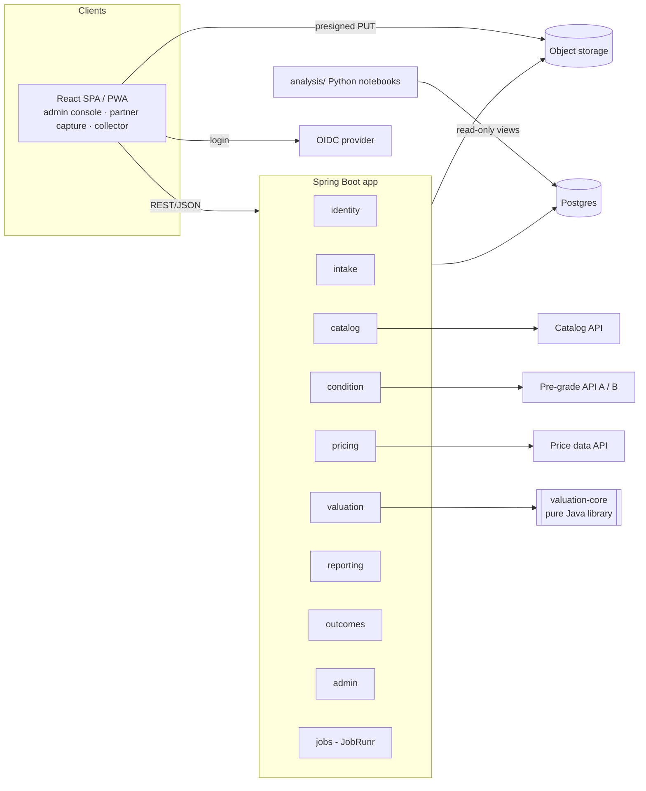
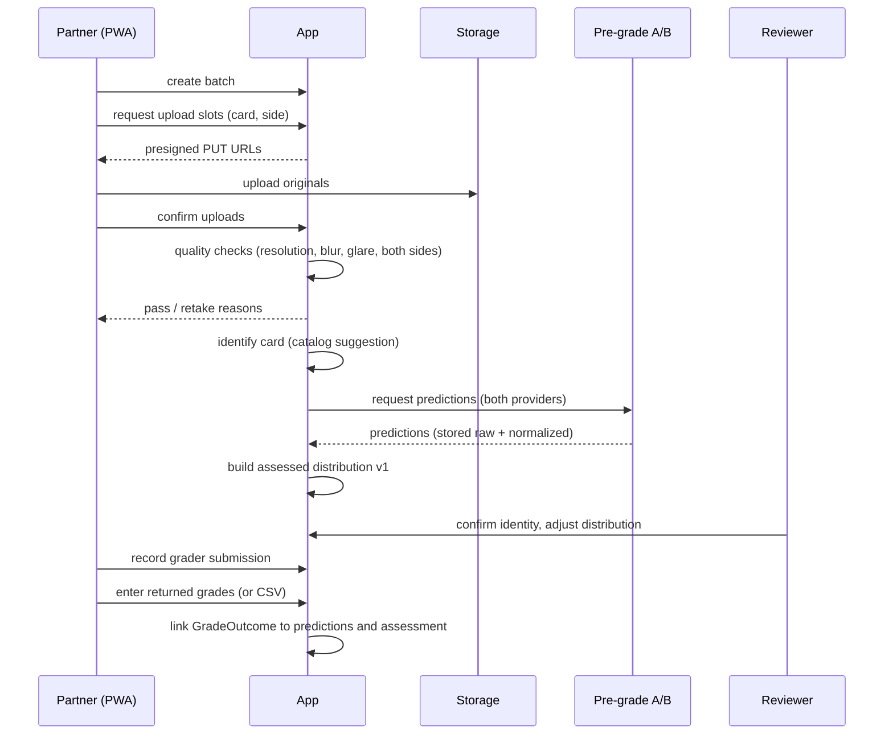
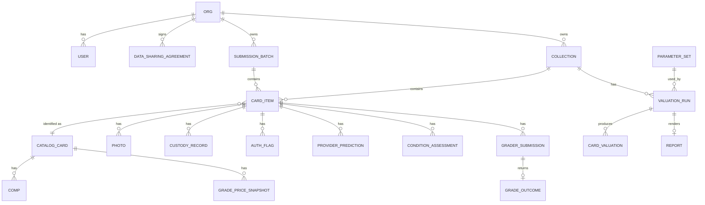

# High-level design: raw collection collateral reports

Status: draft v1 · 2026-10-16 · Zach
Shareable copy: [Raw Collection Collateral Reports: HLD](https://claude.ai/artifact/NH4ParzZyrmGe87Nh7m3Zy) (Claude Doc). This file is the source of truth; update the doc when this changes.

Related: [CLAUDE.md](../CLAUDE.md) (methodology summary) · [Valuation Methodology](https://claude.ai/artifact/1XVmPmLtueJk37u2hXgDmL) · [Leave Project Checklist](https://claude.ai/artifact/2CHCuUTTKJicxmLFNvD1qn)

## 1. Goals and non-goals

**Goal:** a system that turns photos of raw cards into a defensible collateral report (inventory, per-card grade distributions, FMV/RV/QSV/FLV with confidence, portfolio caps, collateral base, grade-first list), and that captures every prediction and its real grading outcome so the method can be calibrated.

v1 (through week 16) must:
- Let submission partners upload photos to a capture standard and later record returned grades.
- Let collectors upload their own collections and receive reports.
- Let the admin/reviewer (Zach) identify cards, review and adjust distributions, manage comps and parameters, and generate reports.
- Produce lender-ready and insurer-ready PDFs.
- Export prediction-vs-outcome and FLV-vs-later-price data for calibration.

Not in v1: a native mobile app, a custom photo model, lender/insurer portals, payments and billing, vault or custody integrations, automated authenticity verification.

## 2. Actors and external systems

| Actor | What they do |
|---|---|
| Admin / reviewer | Everything; works the review queues, owns parameter sets, issues reports |
| Partner user | Belongs to a partner org (shop, group-submission operator); uploads batches, records grader submissions and returned grades |
| Collector | Uploads their own collection, sees their cards and reports |
| Lender / insurer | No login in v1; receives PDF reports |

| External system | Role | Adapter |
|---|---|---|
| Card catalog (e.g. Pokémon TCG API) | Canonical card identities | `CatalogProvider` |
| Pre-grading APIs (two, compared) | Per-photo condition predictions | `PreGradeProvider` |
| Licensed price data | Sold comps per grade | `PriceDataProvider` |
| S3-compatible storage (R2/S3) | Photos, derivatives, report PDFs | `BlobStore` |
| OIDC provider (Auth0/Clerk-type) | Login, MFA | Spring Security resource server |
| Email (transactional) | Invites, report-ready notices | `Notifier` |

Every provider port has a **manual implementation** (the reviewer enters the identity, distribution or comps by hand), so the system never blocks on a vendor.

## 3. Architecture

A modular monolith: one Spring Boot app with enforced module boundaries (Spring Modulith, plus ArchUnit tests), one pure-Java valuation library, one React SPA, and a Python analysis workspace.



### 3.1 `valuation-core` (separate Gradle module)

No Spring, no I/O, `BigDecimal` throughout. Inputs are plain value objects; outputs carry an **explanation trace** (which comps, which rule, which parameter produced each number), which the report renders.

- `GradeDistribution`: 11 outcomes (U, 1–10), validation (sums to 1), `shiftDown(n)` with floor at 1 and U held, photo-confidence and surface adjustments (downward only).
- `GradePricer`: recency-weighted median (30-day half-life), 90 → 180-day window extension, outlier trim at n ≥ 10, missing-grade rule (log interpolation / step-down ratio / never step up), net-of-grading-cost with raw-price override, derived-price confidence drop.
- `CardValuator`: FMV, RV, QSV, FLV; confidence A–D.
- `PortfolioEvaluator`: eligibility, 20% single-card cap, 50% top-five cap, 40% set/character correlation haircut, raw/graded share, advance range for a lender-supplied α.
- `GradeFirstRanker`: lift per card, top 20 with lift > 1.0.
- `ParameterSet`: every constant from the methodology (f, b, s and d tiers, k, t, ℓ floor/cap, half-life, windows, caps, thresholds), loaded from versioned config.

The methodology's worked example (FMV $411 → RV $481 → QSV $314 → stressed FMV $181 → FLV $107 → advance $64) is the first golden test.

### 3.2 App modules

| Module | Owns |
|---|---|
| `identity` | Orgs, users, roles, invites, data-sharing agreements and training consent |
| `intake` | Collections, submission batches, card items, photos, photo quality checks, custody records, authenticity flags |
| `catalog` | Catalog cards and variants, identification (provider suggestion + reviewer confirm) |
| `condition` | Provider predictions (append-only), assessed distributions (versioned), reviewer adjustments, review queue |
| `pricing` | Comp ingestion, per-grade price snapshots, step-down ratio tables, volatility and liquidity stats |
| `valuation` | Valuation runs: snapshot inputs → `valuation-core` → stored results and trace |
| `reporting` | HTML templates, PDF rendering (OpenHTMLtoPDF), report storage and hashing |
| `outcomes` | Grader submissions, returned grades (manual + CSV import), linking outcomes to predictions |
| `admin` | Parameter set versions, review queues, comp overrides, user and org management |

Modules talk through published interfaces and application events (e.g. `PhotosAccepted`, `CardIdentified`, `AssessmentFinalized`, `GradeReturned`), not each other's repositories.

### 3.3 Frontend

One React + TypeScript + Vite SPA with role-based areas:
- **Capture (partner, collector):** batch/collection setup, guided capture checklist, `<input capture>` uploads straight to storage, per-photo pass/fail with retake reasons.
- **Partner:** batch status, record grader submission (grader, tier, date), enter or import returned grades.
- **Collector:** my collection, card status, reports.
- **Admin console:** identification queue, condition review (side-by-side photos, provider outputs, editable distribution), comps browser, parameter sets, valuation runs, report issue.

Installable as a PWA. The upload API is client-agnostic so a future Expo capture app can reuse it.

### 3.4 Analysis workspace

`analysis/` (Python, pandas, scikit-learn, Jupyter) reads from a read-only Postgres role and stable SQL views (`v_prediction_outcomes`, `v_flv_followup_prices`, `v_provider_comparison`). Outputs: calibration curves, ±1-grade hit rate, below-stressed-median rate, the 2021–2023 liquidation replay, and the week 1–2 provider comparison.

## 4. Key flows

### 4.1 Partner submission (the data engine)



### 4.2 Collector valuation

Create collection → capture (cards above $25 individually, cheaper cards as photographed lots) → same quality / identify / predict / review pipeline → admin starts a valuation run against current price snapshots and a chosen parameter set → report PDF generated, hashed and stored → collector notified.

### 4.3 Scheduled jobs (JobRunr, Postgres-backed)

- Nightly comp ingestion per tracked catalog card, then per-grade price snapshots, volatility (12-month σ of 30-day changes), monthly sales counts.
- Weekly step-down ratio recompute per era.
- Retry queue for provider calls and PDF rendering.
- Nightly DB backup check and orphaned-upload cleanup (uploads not confirmed within 24 h, never confirmed photos).

## 5. Data model (core entities)



Notes on key entities:
- **CardItem** is the physical card; **CatalogCard** is the canonical identity (set, number, language, edition, variant, promo). Lots are a CardItem with a quantity and `is_lot`.
- **Photo:** content hash (SHA-256), storage key, side, `captured_at` (EXIF) and `uploaded_at`, quality metrics, training-consent flag inherited from the org's agreement. Immutable; derivatives (thumbnails, crops) are separate keys.
- **ProviderPrediction:** provider, model/version, request id, raw JSONB, normalized 11-outcome distribution, latency. Append-only.
- **ConditionAssessment:** version, distribution, confidence, author (system or reviewer), the adjustments as a diff, reason. A new version for every change, and one is marked current.
- **Comp:** source, external id, sold date, price + currency, grader, grade (half grades kept as-is and folded in pricing), raw/damaged flag, listing type. Asking prices are never stored as comps.
- **GradePriceSnapshot:** per catalog card × grade × date: price, method (`observed`, `interpolated`, `step_down`, `carried_down`, `floor`), comp ids used, n.
- **ParameterSet:** semantic version + JSON body; immutable once any valuation run references it.
- **ValuationRun / CardValuation:** inputs snapshot (assessment version, price snapshot ids, parameter set), the four values, confidence, eligibility, cap adjustments, trace JSON. Re-running with the same inputs must give the same output.
- **Report:** type (lender, insurer), run id, PDF key, SHA-256, issued_at.

## 6. Cross-cutting rules

- **Append-only evidence:** predictions, outcomes, photos and issued reports are never updated or deleted in place. Corrections are new rows.
- **Reproducible reports:** every report ties to exact assessment versions, price snapshots and a parameter set version.
- **Traceability:** every value in a report can be traced back to comps (with dates and counts) and to the rule that produced it.
- **Tenancy:** every org-owned row carries `org_id`. Queries are scoped by a request-level org context, with Postgres row-level security as a second line of defense. Admin is cross-org.
- **Consent:** photos may feed model training only when the uploading org's data-sharing agreement allows it. Exports carry the flag.
- **Money:** `BigDecimal` in Java, `numeric` in Postgres, with currency stored. USD only in v1.
- **Time:** UTC everywhere; sold dates as dates.

## 7. Security

- Managed OIDC (free tier) with Spring Security as a resource server. Roles ADMIN, PARTNER, COLLECTOR. MFA required for ADMIN. ADMIN comes from the token; PARTNER and COLLECTOR come from org membership in Postgres, created by accepting an invite link (decided 2026-10-16). See [auth.md](auth.md).
- Invite-only onboarding for partners in v1. Collectors self-register behind an allowlist until pilots end.
- Presigned upload URLs scoped to one key, short expiry, content-type and size limits. The photo bucket is private with versioning/object lock; reports are served through short-lived signed links.
- Secrets live in the host's environment config, never in the repo.
- Daily managed-Postgres backups with a quarterly restore test. The bucket is versioned.
- Dependency and container scanning in CI.

## 8. Deployment and operations

- **Local:** docker-compose with Postgres and MinIO (Chainguard's build, since MinIO left Docker Hub); seed data includes the worked-example card and a small fake collection. See [local-dev.md](local-dev.md).
- **Prod:** one container (Spring Boot serving the built SPA) on a managed platform, plus managed Postgres and R2/S3. A single environment plus local in v1; add staging only when there are paying users.
- **CI/CD:** GitHub Actions running backend tests (unit, `valuation-core` golden tests, Testcontainers integration), web build and lint, then deploy on merge to `main`.
- **Observability:** structured JSON logs, error tracking (Sentry-type), JobRunr dashboard, and a simple admin health page (queue depth, failed jobs, last comp refresh).
- **Ops budget:** a target under 5 h/week after leave: no self-managed infra, alert only on failed jobs and errors.

## 9. Repo layout

```
backend/
  valuation-core/   pure Java library + golden tests
  app/              Spring Boot modular monolith
web/                React + TS + Vite SPA/PWA
analysis/           Python notebooks, calibration scripts
docs/               hld.md, ADRs
docker-compose.yml
```

## 10. Milestones (mapped to the leave checklist)

| Milestone | Weeks | Scope | Done when |
|---|---|---|---|
| M0 Skeleton | 1–2 | Repo layout, CI, docker-compose, auth wiring, `valuation-core` with full methodology math | Worked-example golden test passes; deploy pipeline green |
| M1 Intake | 3–4 | Orgs/invites, batches, collections, presigned uploads, quality checks, capture PWA | A partner can upload a batch and see pass/retake per photo |
| M2 Identify + condition | 4–6 | Catalog adapter, two pre-grade adapters, manual fallbacks, review UI, assessments | Controlled set has stored predictions from both providers plus reviewed distributions |
| M3 Pricing | 5–7 | Price adapter, comp ingestion job, per-grade snapshots, missing-grade rule, volatility/liquidity | Snapshots exist for the controlled set with method and comp ids |
| M4 Valuation + reports | 8–10 | Valuation runs, portfolio caps, grade-first list, lender and insurer PDFs | First free report delivered from real data |
| M5 Outcomes + calibration | 8–12 | Grader submissions, returned-grade entry/CSV, analysis views, notebooks | First calibration check run (weeks 8–14 item) |
| M6 Collector self-serve + automation | 12–16 | Collector registration, notifications, automated refreshes, admin health page | System runs on about 5 h/week |

## 11. Risks and open decisions

| Item | Notes |
|---|---|
| Employment agreement / IP | Zach is proceeding without clearance and believes it only matters if he charges. Invention-assignment clauses often cover inventions related to the employer's business regardless of monetization, and lending tech is adjacent. Personal accounts and devices only. Revisit before charging, publicizing, or approaching lenders. |
| Price data licensing | Which sources allow commercial use and storage. `PriceDataProvider` keeps this swappable. |
| Pre-grading API terms | Storing results and training our own model may be restricted. Read before M2. |
| Lender error tolerance | Drives confidence thresholds and α ranges; ask during pilots. |
| Custody | Whether to partner with an existing vault. Out of v1; CustodyRecord is manual. |
| Native capture | Revisit if photo rejection data shows phone capture is the bottleneck, or if borrowers become the main channel (React Native + Expo, capture only). |
| Lender pitch drift | The pitch still says three values; the methodology has four (RV added). Update before sending. |
