# UI review: PR #132 (collector Ledger) and PR #133 (labelling tools), 2026-11-13

A user-and-designer pass over the new UI in both PRs, merged together on a local branch and run on the local e2e stack. Nothing here is fixed in #132 or #133; each finding has a suggested fix for whoever picks it up.

## How it was tested

- Both branches (`claude/ledger-slip-flip-timeline`, `claude/labelling-tools-fa6f62`) merged into a local, unpushed review branch.
- The e2e stack: mock OIDC, the API, `vite preview`, Postgres and MinIO in Docker. Test logins only (`collector-rev@e2e.test`, `buyer-rev@e2e.test`, `admin-rev@e2e.test`); no prod, no server.
- Seeded synthetic cards only (drawn checkerboard photos, CSV comps): a Charmander priced and ready for its first offer, and an Eevee sold with its label bought.
- Walked desktop (1280×800) and 375×812, light and dark, with and without `prefers-reduced-motion`.
- Screenshots below are from those seeded cards.

## Summary

| # | Severity | PR | Finding |
|---|---|---|---|
| 1 | High | #132 | The reveal shows the collector a grade chance bar (PSA 10/9/8 with %) |
| 2 | High | #132 | The buyer's timeline tells the buyer "Ship it by …" |
| 3 | Medium | #132 | On a phone the flip plays below the fold, then never replays |
| 4 | Medium | #132 | A seen offer collapses to the bare price; first and later visits differ |
| 5 | Medium | #132 | The reveal back is card-shaped and ~60% empty |
| 6 | Medium | #132 | Deal actions show before the step they belong to |
| 7 | Medium | #132 | Stale seller status text once the label is shown |
| 8 | Medium | #133 | The labelling reveal's two tables fuse into one |
| 9 | Medium | #133 | The reviewer page's new panels push Identity ~2,300px down |
| 10 | Medium | #133 | The reviewer lines panel ignores the keyboard though it takes focus |
| 11 | Low–Medium | #132 | Dark mode: PSA 10 and PSA 8 segments are nearly the same colour |
| 12 | Low | #132 | Slip rows sum to $75.96 against a $75.97 offer |
| 13 | Low | #132 | Tracking number shown two or three times; mixed date formats; "Posted to buyers" twice |
| 14 | Low | #132 | Slip: "PSA 7 or lower — up to $16.51, not counted"; confidence letter shown |
| 15 | Low | #132 | Flip front uses the full original photo, not the crop |
| 16 | Low | #133 | Grade labels inconsistent; "(to confirm)" only in a tooltip |
| 17 | Low | #133 | Labelling page: arrow keys scroll the page; tiny nudge buttons; duplicate route to the back; no image in the reveal |
| 18 | Low | #133 | "Both" column shown when the back isn't measured |
| 19 | Low | #133 | Toggles mix filled buttons and links; default-blue slider; Strength label wraps at 375 |
| 20 | Low | #133 | Surface crops are fit-to-width with no zoom |
| 21 | Low | both | Style clash: #133's plain tables and blue focus ring next to #132's Ledger |

What passed: reduced motion gives a static back with no animation; no sideways scroll at 375 on the card or review pages; text contrast on the reveal back is 6.1–11.2:1; the grader allowances are admin-only (`GET /api/admin/centering-standards` is 403 for a collector, and `GraderAllowances` is only used by `CenteringLabelsPage` and `CenteringLinesPanel`).

---

## PR #132: collector side

### 1. High: the reveal shows the collector a grade estimate

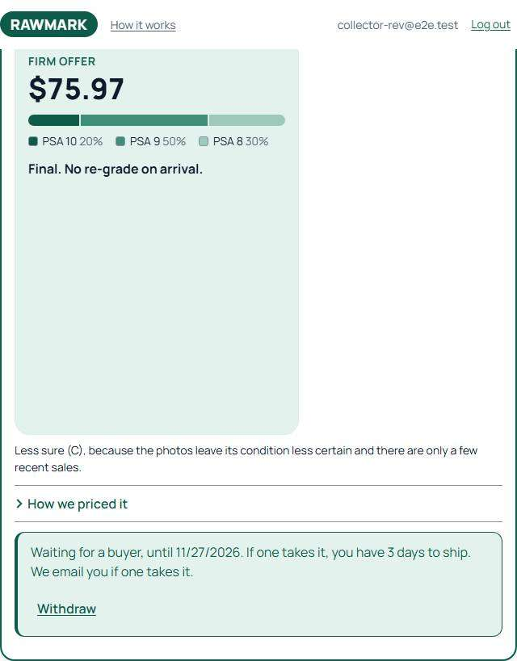

The back of the flip, the headline moment of the product, is a PSA 10 / 9 / 8 chance bar with a legend (20% / 50% / 30%). We sell a price, not a grade: the collector's takeaway should be "$75.97, final", not "Rawmark thinks it's a 9". It also invites the argument the offer is built to avoid ("you said 20% chance of a 10, it came back a 10, pay me more"). The bar is new in #132; the card page on main already says "Likely grade PSA 8–9, most likely 9" and the market chip "Most likely PSA 9 (50%)", which have the same problem and are worth a separate look.

**Fix:** drop the bar and legend from the reveal; keep the price, "Final. No re-grade on arrival." and the expiry. If the chances stay anywhere collector-facing, put them inside "How we priced it" as the reason for the price, not as a headline.

### 2. High: the buyer is told to ship

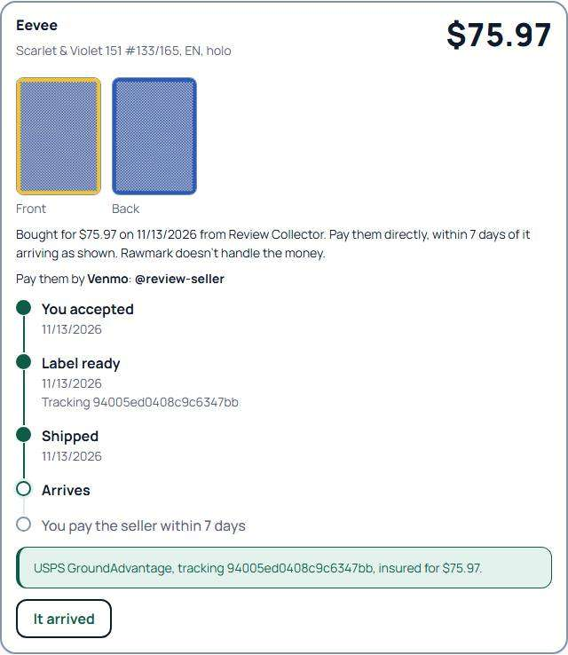

Mid-deal, the buyer's timeline shows "Now: Ship it by 11/16/2026" (the screenshot above is after shipping; before it, the current step reads "Ship it by"). `dealSteps.ts` uses the same title for both roles.

**Fix:** role-aware titles: seller "Ship it by {date}", buyer "Seller ships by {date}". The same pass should check every step title for role (e.g. "You pay the seller" is right for the buyer, the seller's should read "Buyer pays you").

### 3. Medium: on a phone the flip plays below the fold, once

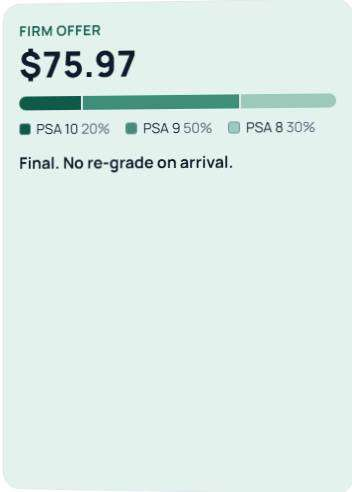

At 375×812 the reveal starts at y≈577, so most of the ~1.3s flip happens off-screen. The offer is then marked seen in `localStorage` (`rawmark.offerSeen.<id>`) and never animates again, so a phone user may never see the moment the design is built around.

**Fix:** start the flip with an `IntersectionObserver` once the card is at least ~60% visible, and only mark it seen after the animation finishes in view. Alternatively scroll the reveal into view after "Get an offer".

### 4. Medium: a seen offer loses its content

On a second visit `OfferReveal` returns only `
`: no "Final. No re-grade", no expiry context. First and later visits look like two different products.

**Fix:** render the same back statically when seen (as the reduced-motion path already does) so only the animation is one-off.

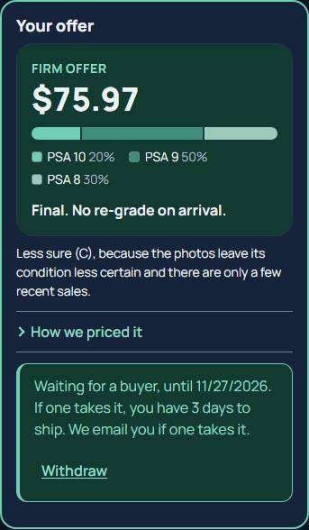

### 5. Medium: the reveal back is mostly empty

The back keeps the card's 63:88 shape (352×491 on desktop, 307×428 at 375) with ~60% blank below the text (see #1's screenshot). It reads as a layout bug and pushes the slip and the Sell button down.

**Fix:** after the flip, let the back shrink to its content (animate `height` or swap to a content-sized panel). If the card shape matters for the moment itself, keep it only during the flip.

### 6. Medium: deal actions show before their step

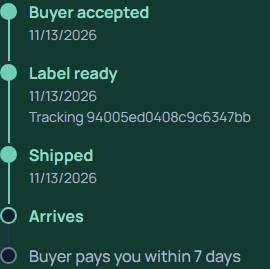

The seller sees "I got paid" / "I haven't been paid" as soon as the card ships, before it has arrived (payment is due within 7 days *of arrival*). The buyer sees "It arrived" before the seller has shipped. This may be pre-existing behaviour that the timeline now makes obvious.

**Fix:** gate each action on its step: buyer "It arrived" after Shipped; seller "I haven't been paid" after Arrived (or 7 days after it), "I got paid" after Arrived.

### 7. Medium: stale seller status text

With the label already on screen, the status still says to "ship it with the prepaid label once it shows on this card's page".

**Fix:** switch the copy when the label exists: "Print the label below and ship by {date}."

### 11. Low–Medium: dark mode segment colours

In dark mode `.seg-1` (#6fcfb2) and `.seg-3` (#9cc9b9) are almost the same lightness against the background (6.7 vs 6.85:1), so PSA 10 and PSA 8 are hard to tell apart without the legend. Also `.seg-1` (the accent) goes to the highest grade rather than the most likely one. Moot if #1 removes the bar; otherwise space the three steps in lightness and give the accent to the most likely grade.

### 12–14. Low: the slip and the timeline text

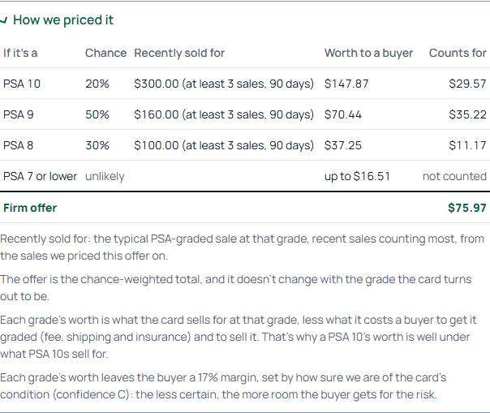

- **Rounding.** The rows sum to $75.96 against a $75.97 offer. Either round the rows so they add up, or add "Rows are rounded; the offer is exact."
- **"PSA 7 or lower — up to $16.51, not counted".** A row that doesn't count but shows a price is confusing. Show it as "PSA 7 or lower: 0%, not counted" or drop it.
- **Confidence letter.** The slip shows "confidence C" (admin set B; the effective one is C after the offer's penalties). A letter grade next to a price reads like a card grade. Say it in words ("less sure, because …", as the line under the reveal already does) and drop the letter. May be pre-existing.
- **Tracking number** appears in the timeline's "Label ready" step and again in the shipping line below (and in the label line on the seller's side). Keep it once, in the step.
- **Dates.** "Ship by Nov 16" and "Nov 27" sit next to "11/27/2026". Pick one (the short "Nov 16" reads better on a phone).
- **"Posted to buyers"** appears twice on the seller's card page (status and timeline). Keep the timeline's.

### 15. Low: the flip front uses the full photo

The front face shows the original photo with `object-fit: cover`, table and all, rather than the card crop used elsewhere. **Fix:** use the cropped front.

---

## PR #133: admin and reviewer side

These are admin and reviewer screens, so grader allowances are fine here. None reach a collector page.

### 8. Medium: the labelling reveal's tables fuse together

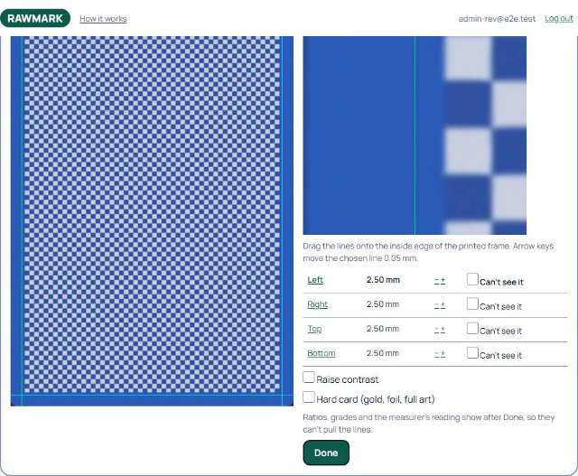

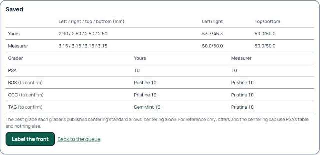

After "Done", `Reveal` renders the measurement table and the grader table back to back with no gap, so the "Grader / Yours / Measurer" header reads as a body row and the columns don't line up.

**Fix:** a small heading ("What each grader allows") and spacing before the second table, or one table with a section row.

### 9. Medium: Identity is pushed far down the reviewer page

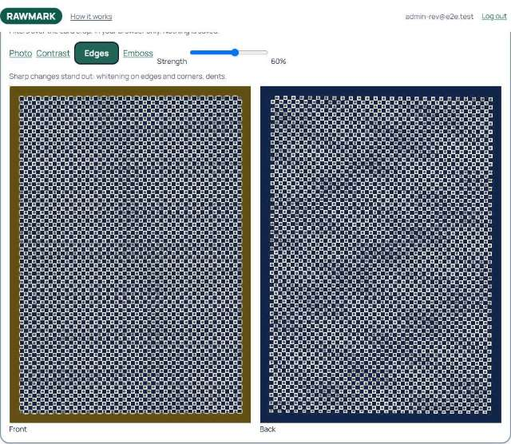

The surface view (~860px tall) and the centering lines panel now sit above Identity, which starts at y≈2,309 on desktop. Identity is the reviewer's first task on a new card.

**Fix:** move both panels below Identity and the distribution, or put each in a collapsed `
` with a one-line summary.

### 10. Medium: the reviewer lines panel and the keyboard

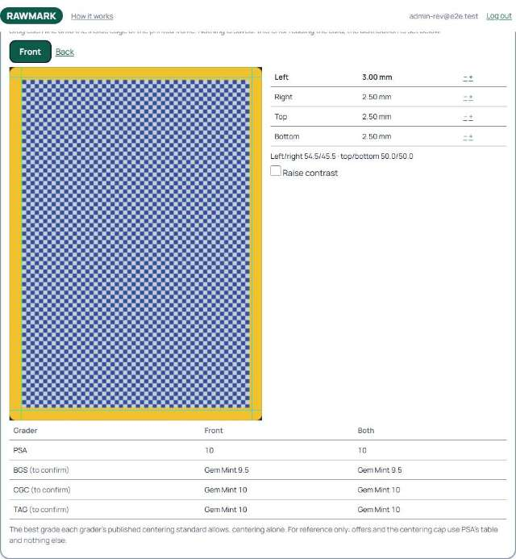

`CenteringLinesPanel`'s frame card has `role="img"` and `tabIndex=0` but no `onKeyDown`, so it takes focus and then does nothing; only the small − / + buttons work. It also lacks the close-up zoom the labelling page has, and its lines are a faint green over the yellow card border.

**Fix:** reuse the labelling page's key handler and zoom (or drop `tabIndex` until it has them); draw the lines in a colour that contrasts with both borders and the art (e.g. magenta with a dark outline).

### 16. Low: grader labels and "(to confirm)"

- PSA shows a bare "10" while the others show "Pristine 10", "Gem Mint 9.5". Use PSA's names too ("Gem Mint 10") or bare numbers for all.
- "(to confirm)" is explained only in a `title` tooltip, which keyboard and touch users can't reach. **Fix:** a visible footnote under the table: "BGS, CGC and TAG values are from their published standards and not yet confirmed."

### 17. Low: the labelling page

- `onKey` handles only the chosen line's axis, so Up/Down on a vertical line scrolls the page. Call `preventDefault()` for all four arrows while the editor has focus.
- The − / + nudge buttons are small tap targets; make them at least 44×44 at 375.
- The Front/Back toggle stays above "Saved", next to "Label the back": two routes to the same thing. Hide the toggle after Done.
- The reveal is numbers only. An image of the card with your lines and the measurer's overlaid would make the difference obvious, which is the point of blind labelling.
- The centering list's "Label" link column has no header.

### 18. Low: "Both" when the back isn't measured

The lines panel shows a "Both" column even when the back is unmeasured, so it just repeats the front. Hide it, or show "Back not measured".

### 19. Low: toggle and slider styles

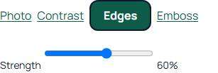

Front/Back and the surface modes mix a filled button (active) with underlined links (inactive). Use one segmented control. The Strength range input is the browser's default blue; set `accent-color: var(--color-accent)`. At 375 "Strength" wraps under the slider with "60%" floated right; stack label, slider, value in one row with the slider flexing.

### 20. Low: surface crops have no zoom

The edge and corner crops are fit-to-width (656px tall on desktop) with no zoom, which makes corner whitening hard to judge. Add tap-to-zoom, or reuse the labelling page's close-up.

---

## 21. Both: style clash

#133 keeps its styles in `reviewTools.css` with plain tables and buttons, while #132 restyles the collector side as the Ledger (cards, mint accent, ruled rows). Admin screens don't need to match exactly, but the shared pieces do: the global dark-mode focus ring (`--color-focus` #7fa6ff, blue) clashes with the Ledger's mint accent on every collector page. **Fix:** a mint or white focus ring in dark mode that still meets 3:1 against both backgrounds, and give #133's tables the Ledger's row rules and spacing once #132 lands.

**Fixed (finding 21):** the focus ring is now the Ledger green (`#0f5b4a` light, `#8fdcc5` dark; both over 3:1 on the page and surface colours), the labelling tables use the Ledger's ruled rows and small-caps heads (`table ruled`), and the surface slider has a ruled track and a green thumb.
