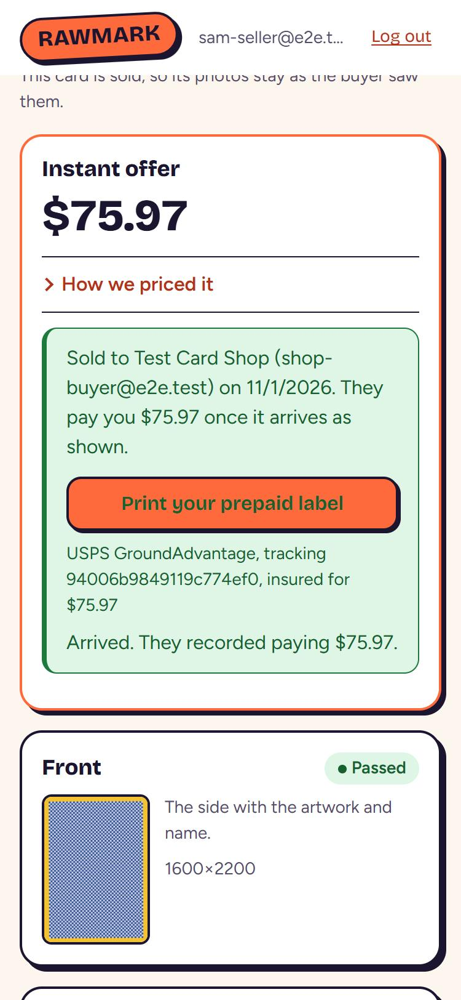
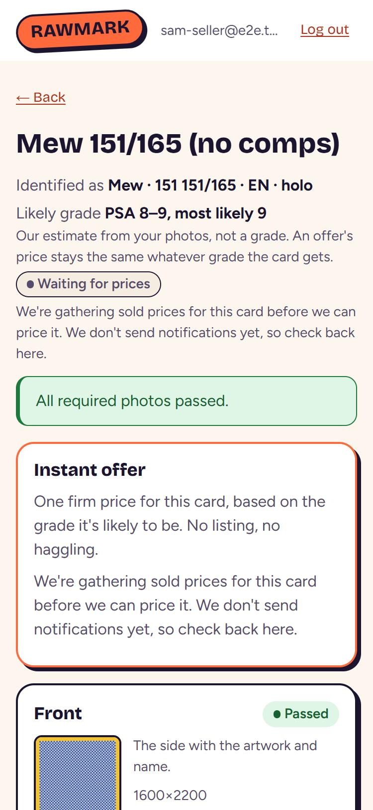
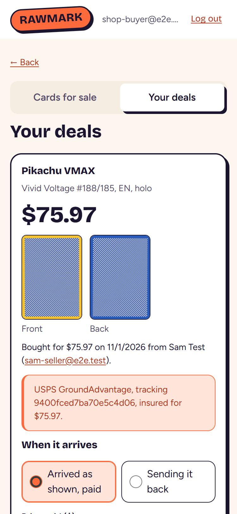
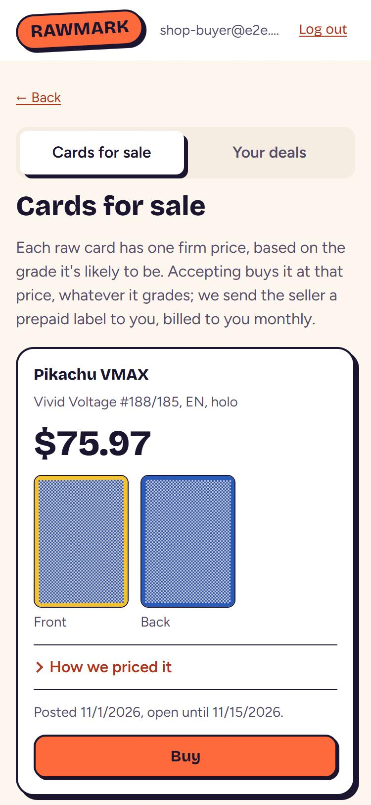
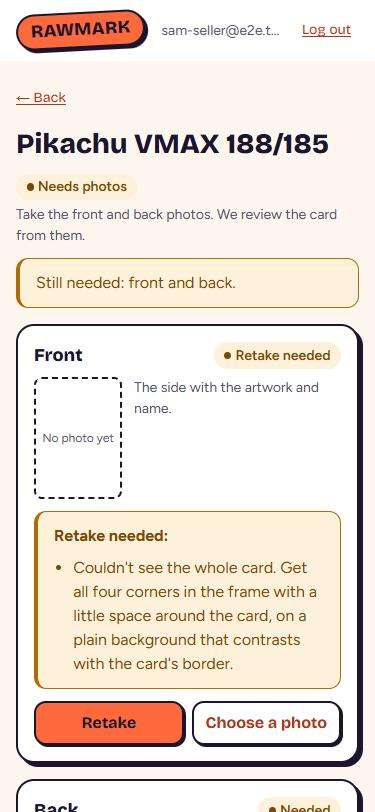

# UX review, 2026-11-01

An honest look at Rawmark as a first-time user meets it. Assessment only: no app code changed. What was found stands as written; later PRs fix parts of it.

## Verdict

**Could a stranger get through the seller flow today without help? No.**

- **Through the photos: yes.** From an invite link to two passed photos, the app is clear and works well on a phone.
- **Through to an offer: not on prod.** With no comps, every card stops at "Waiting for prices" and nothing tells anyone it's stuck.
- **Through to being paid: no, even with comps.** The screens never say that a stranger pays them off the app, they don't say how to pack the card, and the seller has 3 days to ship from a label nobody tells them about. Those facts exist only in the terms, which can't be reopened after agreeing.

The screens are in better shape than the flow. Layout, tap targets, photo messages and the two-step confirms are good. The harm is in what happens after "Sell": the part where a real card leaves someone's hands.

## How this was tested

I ran the e2e stack on private ports, with the mock login and the fake shipping provider, and drove it in the built-in browser. Phone (375 px) came first, with spot checks at 1024 px and in dark mode. All the data was throwaway and the stack has been removed. I did not open prod.

| Saw running | Only read in code | Not covered at all |
|---|---|---|
| Signed-out page, invite, seller terms, collections, add card, photo pass and rejections | Withdraw, expired offer, voided offer, cancelled deal | Real Auth0 sign-up and MFA |
| Every no-offer state (no comps, one grade of comps, under $25, over $5,000) | Label failure and retry | A real phone camera, iOS |
| Offer, "How we priced it", address, posting, sold, arrived, returned | Admin void, cancel, refund actions | A real EasyPost label, printing one |
| Buyer terms, market, buy, deals, arrival, return | TCGdex search, card reading, provider panels | Two buyers racing for one card |
| Admin orgs, invites, queue, card review, deals, labels, postage, track record, graded results | Centering wording (off in this stack) | Screen readers |
| Contributor invite, terms, empty collection, card page | The graded-result form (needs raw photos first) | How the photo checks treat a slab |

## Findings, worst first

### 1. Sellers aren't told who pays them, or how, and can't chase payment

**Evidence.** The card page says "Instant offer", "$75.97" and "Sell for $75.97". Neither that panel nor the confirm step mentions payment. The confirm reads "If a buyer accepts, you're committing to ship them the card". The first mention on screen comes after the sale: "They pay you $75.97 once it arrives as shown." It doesn't say how. Neither side has anywhere to enter a payment method. The seller gets the buyer's email and that's all. Once the buyer records an arrival, the seller sees "Arrived. They recorded paying $75.97." The seller can't confirm or dispute that, and no button says "I wasn't paid".

**Why it matters.** "Instant offer" reads like Card Buyers or poko.cards: we buy it and we pay. A collector who mails a $500 card believing that is in for a nasty surprise. This is the biggest trust risk in the product.

**Fix.**
- Say it before commitment, in the panel and the confirm step: "A buyer pays you directly, by [method], within 7 days of the card arriving. Rawmark doesn't handle the money."
- Add a payment handle (PayPal, Venmo, Zelle) to the seller's address form, shown to the buyer after accepting.
- Give the seller "I got paid" and "I haven't been paid", and a pay-by date on both sides.
- Consider whether "Instant offer" is the right name for a price that still needs a buyer.

**Effort.** Copy: small. Handle and confirmations: medium.

### 2. A card with no comps is a silent dead end, and the admin queue says everything's done

**Evidence.** With identity and condition saved but no comps, the seller sees "Waiting for prices" and "We're gathering sold prices for this card before we can price it. We don't send notifications yet, so check back here." It appears twice on one screen. A card with real sales in one grade (three PSA 10s) says exactly the same, though it can't be priced until someone adds a second grade. Meanwhile the review queue read **"0 to review, 5 done"** with two cards unpriced: `ReviewQueuePage` counts a card as done once it's identified and reviewed, whether or not it has prices. The review card's offer preview does say why, but only at the bottom of the card's page.

**Why it matters.** This is every card on prod today. "We're gathering" is a promise no process keeps, and the one person who could act is told there's nothing to do. Sellers check back a few times, then leave.

**Fix.**
- Add a "needs comps" state to the queue, with a count, and show the refusal reason there.
- Change the seller's copy to what's true, with a time: "We don't have enough sold prices for this card yet. We add them by hand, and it can take a week. No need to keep the card aside."
- Say the same once on the screen: the status line and the offer panel repeat it.

**Effort.** Small.

### 3. Deadlines run on events nobody hears about

**Evidence.** The seller terms give 3 days to ship from the label showing. The app sends no notifications. A posted card's page says only "Waiting for a buyer, until 11/15/2026" and doesn't mention checking back or the deadline. From home it takes two taps to reach the card list and a third to open a card, and nothing on the way flags a sold card or a 7-day offer about to lapse. The same goes for buyers: no pay-by date appears anywhere. `docs/beta-readiness.md` still has "who sends notifications by hand" open.

**Why it matters.** A seller who sells on Tuesday and looks on Saturday has already broken the terms without knowing. This turns willing testers into rule-breakers, and it's what the Discord beta will trip on first.

**Fix.**
- Make home a "Needs you" list across collections: label ready to ship (with a due date), offer ready, offer expiring, retake needed.
- Show deadlines as dates on the card.
- Send just these two emails ahead of the rest of M6: "a buyer took your card" and "your card arrived, pay within 7 days". Until then, decide who sends the Discord DMs.

**Effort.** Home list: medium. Two emails: medium.

### 4. The buyer's arrival form can record things that didn't happen, and a return leaves the seller stranded

**Evidence.**
- The form appears the moment a card is bought. "Arrived as shown, paid" is preselected with the price filled in. One tap on **Record** saved it, with no confirm step, in the same minute as the purchase and before any card could have shipped. It can't be undone.
- It also joins two facts. A buyer can't say "it arrived, I'll pay this week", though the terms give 7 days.
- Marking a card "not genuine" takes a radio button, a dropdown and **Record**. It needs no note and no photo, and the result sits in a green success box on the buyer's side.
- The seller then sees "They're sending it back: not genuine." Nothing else changes. The chip still says "Sold", the next step still says "ship it with the prepaid label", and **Print your prepaid label** is still there. The seller gets no explanation and no way to reply, and can't get a new offer once the card is back. The same stale text shows after a clean arrival.

**Why it matters.** A mistaken tap tells the seller they've been paid when they haven't. An unexplained "not genuine" is an accusation with no appeal, and the terms promise Zach decides disputes while the app gives no way to raise one.

**Fix.**
- Don't show the form until the label's tracking shows a scan or delivery. If that's too much for now, hide it behind "It arrived", with nothing preselected.
- Split arrived from paid (audit finding 5).
- Require a note for "not genuine", and show a confirm step.
- Add seller stages after Sold: Shipped, Arrived, Paid, Returned, each with its own next step. Hide the label once it's used. On a return, show what happens next and let the seller ask for a new offer once the card is back.

**Effort.** Form: small to medium. Stages: medium.

### 5. The contributor flow doesn't explain itself, and Discord was just pointed at it

**Evidence.** After accepting the terms, a contributor sees the **"How selling works"** panel and nothing about contributing. To give one graded example they must make a collection and a card. The one sentence that says what's wanted, "Add the raw front and back photos first (taken before the card was graded)", sits low on the card page, under **Take photo** buttons that open the camera. A contributor holding a slab will probably photograph the slab. I didn't test what the photo checks do with one. An "Instant offer" panel also shows on the card. The terms promise "a free collection report", but reports are off.

**Why it matters.** This is live now. A wasted evening for a volunteer is bad, and slab photos filed as raw photos are worse, because the point of this data is calibration. An unkept promise in signed terms is its own problem.

**Fix.**
- Give contributors their own "How contributing works", and put the raw-photos rule at the top of the card page.
- Lead with **Choose a photo** for contributors, since they're looking for old photos, not taking new ones.
- Hide the offer panel unless they mean to sell.
- Either honour the report by hand or change the terms, which needs a new version string.

**Effort.** Small, plus one terms decision.

### 6. Shipping instructions are missing from the shipping screen

**Evidence.** The sold panel has a label button, the carrier and tracking. It doesn't mention the sleeve, toploader and bubble mailer, the 3-day limit, or what to do without a printer. Those live in clause 3 of the terms, and terms can't be reread (finding 7). The tracking number is plain text on both sides, with no link. The label button is also the hardest thing to read on the page: an `.alert a { color: inherit }` rule turns its text green on orange, **2.68:1 in light mode and 1.69:1 in dark**. AA needs 4.5:1.

**Why it matters.** This is the moment a card is most at risk, and the app has the seller's full attention.

**Fix.** Put a short checklist under the button: sleeve, toploader, bubble mailer, label on, drop off by [date]. Link the tracking number. Exempt `.button` from the `.alert a` rule.

**Effort.** Small.

### 7. Little to trust before mailing a card

**Evidence.**
- The signed-out page is the logo, "Instant offers on raw cards." and **Log in**. It doesn't say who runs this or how it works.
- The first real screen after an invite is the wall of terms, before "How selling works".
- The terms say "Ask Zach" and "tell us" but give no surname, email or Discord handle. Nothing in the app has a contact route or a help link.
- After agreeing, the terms can't be reopened. The page only says "You accepted the seller terms on 11/1/2026."
- "How selling works" disappears the instant the first collection exists, at step 1 of its 5 steps, and can't be found again.
- If we misidentify a card ("first edition" when it's unlimited), the seller can't say so.
- `docs/tester-guide.md` would cover much of this, but it's unmerged on `claude/vigorous-kepler-dd8409` and still says `[APP NAME]` and $500.

**Why it matters.** Local Discord testers will trust Zach personally. Their friends won't, and a stranger has no way to tell a beta from a scam.

**Fix.**
- Add a permanent "How it works" page linked from the header, covering firm price, who pays, shipping, returns, who runs it and how to reach them. Reuse the tester guide.
- Link the terms from it.
- Put "How it works" before the terms in the invite flow.
- Add "Something wrong? Tell us" on the card page.
- Merge the guide, or retire it in favour of this page.

**Effort.** Small to medium.

### 8. Buyers commit on thumbnails, without the full cost

**Evidence.** Listing photos render **96×133 px** on a phone, and tapping opens the raw file in a new tab. Yet "doesn't match its photos" is one of only three return reasons, so those photos are the contract. The likely grade is hidden inside "How we priced it". Postage is "billed to you monthly", with no figure before buying. The confirm step doesn't mention postage or the 7 days. A buyer who skipped the address form on the org page learns they need one only after pressing Confirm, and has to leave the page, on a market where the first to accept wins.

**Why it matters.** Vendors are who the beta needs to take cards, and "if the vendors laugh" is already a stop condition. People who buy cards for a living zoom in on corners.

**Fix.**
- Show large photos that can be swiped and zoomed in the app.
- Put the likely grade and "close-up included" on the listing.
- Show estimated postage in the confirm step.
- Ask for the address before the market, not after Confirm.

**Effort.** Medium.

### 9. Photo failures can go unseen, and the first attempt gets no help

**Evidence.** The rejection reasons themselves are good: each one says what to do. But:
- A failed upload's message renders at the top of the page. With the Close-up slot in view on a phone, it landed **481 px above the screen**. The spinner just stops and nothing else changes. That covers "The photo didn't upload", which was added to help.
- A rejected photo isn't shown back, so "Couldn't see the whole card" leaves the seller guessing. The slot still says "No photo yet", even above "5 attempts, all kept; the one shown is used" when no photo is shown.
- "Photos must be JPEG or PNG" doesn't say what to do. It should tell an iPhone user how to fix it.
- There are no tips before the first shot: plain contrasting background, out of the sleeve or not, no flash. Sellers learn by being rejected.

**Why it matters.** Photos are where every seller starts, and the expensive mistakes (blurry, sleeved, glare) cost a retake each.

**Fix.** Show errors inside the side's panel. Show the rejected shot beside its reason. Hide the attempts line when nothing passed. Add a one-line tip above the first **Take photo**.

**Effort.** Small.

### 10. The seller can't see what would have raised the price

**Evidence.** Close-up is marked "Optional", with no consequence given. The admin page warns that a modern holo can't reach confidence A without one, and confidence sets the buyer margin (10, 13 or 17%). So skipping it can cost the seller money, and they're never told. There's also no way for the reviewer to ask for a retake or a close-up.

Centering works the same way. Sellers see it only when it's measured. A front that reads "not measured" says nothing to them, and it isn't a seller's error to fix anyway. The reviewer sees raw internals such as "the card's edges don't make a 63 × 88 mm outline (1.395 wide per high)". The separate centering session owns detection. This finding is only about the wording and the missing request.

**Why it matters.** It's money left on the table, and it's the seller's own choice that they aren't told about.

**Fix.**
- Replace "Optional" for holos with "Recommended: a clear close-up can improve your offer".
- Give the admin a "Ask for a new photo" action with a reason, which shows as the seller's next step.
- Keep "not measured" away from sellers, except when a retake would really help. Then say what to change, for example "flat, square-on, no sleeve".
- Translate the reasons on the admin page.

**Effort.** Copy: small. Retake request: medium.

### 11. The offer gives its reasoning but not its evidence

**Evidence.** "How we priced it" is the best explanation in the app, but it stops short of the proof. In the test, three PSA 10s sold around $300, and the table shows "Worth to a buyer $147.87" and an offer of $75.97. The seller never sees $300, or any sale. "Confidence C" appears with no meaning beyond the margin. "Evidence over opinion" is a founding principle, and the seller sees none of the evidence.

**Why it matters.** Every collector will check eBay in the next tab. An offer that looks like a quarter of PSA 10 money needs to show its working, or it reads as a lowball.

**Fix.** Add a column, "Recently sold for", with the count and window, e.g. "$300 (3 sales, 90 days)". Word confidence for people, e.g. "We're less sure of this one because of how few sales there are". Check the comps source allows showing these, per the licensing constraint.

**Effort.** Small to medium.

### 12. Wrong words and extra steps on the way in

**Evidence.**
- "Your orgs", "Collector", "Account details" (with the raw login subject and token claims) are internal terms on the first screen.
- An org is named by Zach, so a seller "joins Sam Test".
- A collection must exist before a card can, which is an extra step and a naming decision for someone with one card to sell.
- After creating it, you stay put and have to tap in.
- "One card worth $25 or more" asks for a judgement the app is there to make, and a $10 card waits for a human review to be told no.
- "Lot of cheaper cards" offers something that never gets an offer, and it's noise on the main form.
- "Instant offer" sits directly above "usually within a couple of days".

**Why it matters.** None of these stop anyone alone, but together they make the app feel like an internal tool.

**Fix.**
- Rename: "Your cards" for "Your orgs", "binder" or nothing for "collection".
- Skip the org page when there's only one org.
- Create a default binder so "Add card" is the first action.
- Hide lots from collectors.
- Call the panel "Your offer" until there is one that's truly instant.

**Effort.** Small to medium.

### 13. Admin: one data risk, and the rest is tolerable

**Evidence.**
- Hand-entered identity defaults Variant to **holo**, on the path used when a card isn't in the catalog. A missed dropdown makes a non-holo card holo, which changes the comps it attaches to.
- The card page runs 3,000 to 4,900 px on a phone, with the offer preview last. Authenticity and an empty providers panel sit between comps and condition.
- The queue has no thumbnails and no "waiting since". A date is shown, but not how long it's been.
- A return for "not genuine" raises nothing on Offers and deals. It's one line in a list, so disputes have no queue.
- Each admin page links to a different set of the others.

**Why it matters.** Zach is the only user here, so the design issues cost nobody else. The default and the missing dispute signal can hurt other people.

**Fix.** No default variant: force a choice. Add a "needs attention" count on `/admin` for no comps, returns and overdue labels. Move the offer preview to the top. Leave the rest.

**Effort.** Small.

### 14. Pages don't announce or reset on navigation

**Evidence.** Moving from a list to a card keeps the old scroll position: the card opened with its heading 68 px above the screen. Focus stays on the body, and the page title is "Rawmark" everywhere. A screen-reader user hears nothing when the page changes. Refused pages show raw text: a non-admin at `/admin` gets "GET /api/admin/orgs failed: 403", and "Page not found." offers no way home.

**Why it matters.** Mis-scrolling hits every phone user on any list long enough to scroll. The rest is mostly about accessibility and polish.

**Fix.** On route change, scroll to top, move focus to the `h1` and set the title. Add a link home to error pages.

**Effort.** Small.

## Good enough, leave alone

- **Tap targets.** Everything on the card page measured 44 px or more, except the 42 px logo.
- **Phone layout.** No sideways scroll on any page I measured. One column works.
- **Rejection reasons.** Clear and specific, apart from the JPEG line in finding 9.
- **Two-step Sell and Buy.** They stop slips, and the sticky action bar keeps Sell in reach. Add content to the confirms, not steps.
- **"How we priced it".** Keep the table and the plain wording. Add evidence only.
- **Address form.** Proper labels, autofill hints and inputs, and the buyer's "Add your address" link is a good touch.
- **Empty market and deals, labels page.** Clear and honest.
- **Identity shown to the seller, likely grade, "not a grade" caveat.** Well judged.
- **The visual style and dark mode.** Apart from the label button.
- **"We don't send notifications yet".** Blunt and honest, and worth keeping until it's false.
- **Admin pages at phone width.** Long, but usable. Don't spend time here beyond finding 13.

## What I'd do first

Before more Discord testers arrive, in about a day:

1. Finding 5's contributor copy and top-of-page rule.
2. Finding 2's honest copy and queue state.
3. Finding 1's payment sentence on the panel and confirm step.
4. Finding 6's shipping checklist and the button colour.
5. Finding 4's confirm step on Record, with nothing preselected.
6. Finding 9's error placement.

Before a real card ships between strangers: payment handles and confirmation (1), seller stages after Sold (4), the "Needs you" home and two emails (3), and the How it works page (7).
