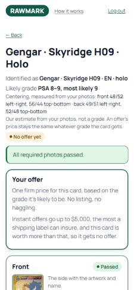
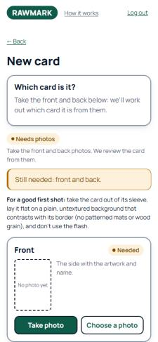
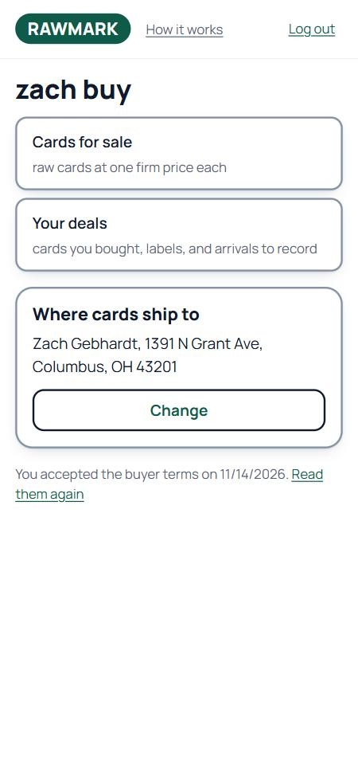
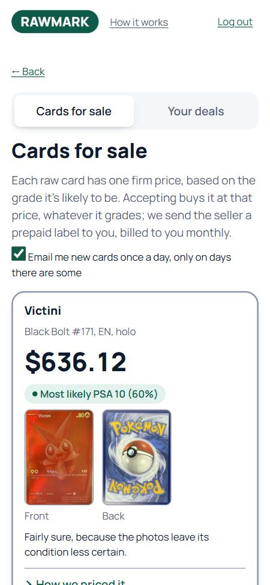
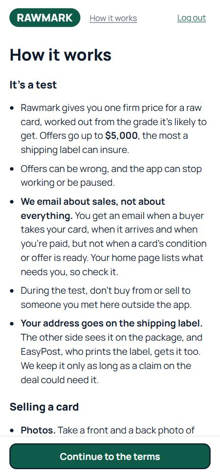

# UX review, 2026-11-23

This review walks the beta as a collector and as a buyer, at phone width (375px) and on desktop. Prod runs PR #173. PRs #174 (Start buying, account page) and #175 (the last round of fixes) are merged but not deployed, so this review read them in code on `main`. PR #171, which makes the offer follow on its own, is still pending. Nothing from PR #175 is repeated here.

## Verdict

The sale half reads well. The label, the shipping steps, "I got paid" and the return flow each say what happened and what comes next.

The slow part is between the photos and the firm offer. Once the collector says which card it is, the page never updates again. The offer turns up only if they reload and then tap "Get an offer". Nothing on Home says a card is waiting for them, and no email tells them when the offer is ready. Some cards also sit for weeks on admin steps the collector can't see.

Start buying is close. Its form tells buyers something false about what sellers see, asks again for an address we already have, and promises an approval nobody will hear about.

Count: 4 high, 8 medium, 8 low. Six need Zach's decision: 1, 3, 4, 6, 8 and 10.

## How this was tested

| | |
|---|---|
| **Saw running** (beta.rawmark.app, phone 375px and desktop) | First visit to an org whose terms haven't been accepted (How it works, then the terms gate; not accepted). A new card page. The over-cap Gengar card. Zach's sell org and buy org. The market with one live listing (not bought). The admin review queue. The admin card delete, used once to remove the one test card this review made. |
| **Only read in code** (`main`) | Photo upload, the reader's suggestion, search and the describe form, because the repo has no card photos to upload and R2 photos can't be fetched across origins. Confirming the identity, assessment, and the offer reveal for no offer, under-minimum and subject to authentication. Selling, and every SoldPanel stage. Start buying, the account page and `BuyingNotice` (#174). NeedsYou and `CardStatusService.need`. |
| **Not covered** | Real uploads on an iPhone or Android camera. Any email as it arrives in an inbox. The admin buyer-approval page in use. Accepting a listing and the buyer's label. |

Prod still shows the "No offer yet" chip on the over-cap card. PR #175 fixes that, so it isn't listed.

## Findings, worst first

Each finding gives a severity, where it is, the size of the fix (S, M or L), and whether it needs Zach.

### 1. After "Yes, this is my card", the page never moves again

**Severity:** high · **Where:** `web/src/pages/IdentifyPanel.tsx:71`, `:385`; `web/src/pages/CardPage.tsx:237` (StatusLine); `web/src/pages/OfferPanel.tsx:132`, `:187`; `web/src/pages/NeedsYou.tsx:71` · **Size:** M · **Needs Zach:** yes, on the email

**Evidence.** IdentifyPanel polls only while the reader is running (`usePoll(data?.step === 'READING', …)`). After the collector confirms, the page says "We'll check it against your photos before making an offer." StatusLine and OfferPanel each load once. Nothing updates through checking the identity, assessing the condition and pricing. The offer appears only after a manual reload and then a "Get an offer" tap. NeedsYou says plainly that no email goes out when the condition or the offer is ready.

**Why it matters.** This is the moment the product exists for. A collector who waits on the page sees nothing happen. One who leaves has no reason to come back. Either way the offer, which is the hook, reaches them late or never.

**Fix.**
- Poll the card status every 5–10 s while the stage is IDENTIFYING, ASSESSING or PRICING. Reload the offer panel when the stage changes.
- Say roughly how long each wait usually takes. A spinner without a time looks stuck.
- PR #171 removes the "Get an offer" tap. Land it first.
- **Decision:** email the collector when an offer is ready, or keep relying on them to come back. One email per card, at most, would be enough.

### 2. Home doesn't list cards that wait on the collector to say which card it is

**Severity:** high · **Where:** `backend/app/src/main/java/com/pokemans/app/offers/CardStatusService.java:124` (`need`); `web/src/pages/NeedsYou.tsx` · **Size:** S · **Needs Zach:** no

**Evidence.** `need()` returns nothing for IDENTIFYING. So a card whose reader made a suggestion, or that fell back to search, never shows up in "Needs you". That's true even though the server's own next step says "Confirm which card it is under 'Which card is it?'". A card that's waiting on us doesn't show either, so Home can't tell "you owe us a tap" apart from "we're on it".

**Why it matters.** The identity answer is the last thing the collector has to do before an offer. When it has no reminder, a card can stall there for good.

**Fix.** Add a `CONFIRM_CARD` need for IDENTIFYING with a suggestion or search pending: "Tell us which card this is". Optionally, add a quiet "We're checking N cards" line for cards that are ASSESSING or PRICING.

### 3. Cards wait weeks on admin steps, and nobody sees how long

**Severity:** high · **Where:** admin review queue (seen running); `CardStatusService.java:200` (PRICING copy) · **Size:** S (code), plus an ops decision · **Needs Zach:** yes

**Evidence.** In the review queue, Tina (Giratina VSTAR GG69, Chimes bulldog) has said "Needs comps: no PSA prices yet" since 11/1. Five Chimes cards have "System distribution, not reviewed". The collector's copy says "We add them by hand, so it may take a while", with no date.

**Why it matters.** The second tester's cards are the first real outside use. Three weeks of silence on a card reads as abandoned.

**Fix.**
- Show each item's age in the admin queue and sort the oldest first.
- On the collector's card, say when we started waiting.
- **Decision:** a turnaround target for adding comps by hand, such as 3 days, and whether to tell collectors it. Also decide whether cards that only need comps get an "it won't get an offer" answer after that time, instead of waiting indefinitely.

### 4. Start buying says "Sellers never see it" about the name sellers do see

**Severity:** high · **Where:** `web/src/pages/AccountPage.tsx:149`; contradicted by `web/src/pages/SoldPanel.tsx:121`, `:328` in OfferPanel, and `ListingViews.Party` · **Size:** S · **Needs Zach:** yes

**Evidence.** The name field's hint says "Your name or your shop's. Sellers never see it." The seller's sold panel says "Sold to {buyer org name}", and so does the cancelled notice. How it works also says the other side sees the org's name.

**Why it matters.** It's a false privacy promise in the form a buyer signs. Someone who types their real name because of that hint finds it on a stranger's screen.

**Fix.**
- **Decision:** should sellers see the buyer's name?
- If yes, change the hint to "Sellers see this name on cards you buy."
- If no, show sellers "a buyer" and keep the name for the admin only. That's M, since `ListingViews.Party` and its tests change.

### 5. Start buying asks again for an address we already have

**Severity:** medium · **Where:** `web/src/pages/AccountPage.tsx:106` (`useState(EMPTY)`) · **Size:** S · **Needs Zach:** no

**Evidence.** Someone who already sells here has a ship-from address in `/api/orgs/{id}/ship-address`. The buyer form starts empty and asks for seven fields again on a phone.

**Fix.** Prefill from the seller org's ship-from address when there is one, minus the payment fields, with a line saying where it came from.

### 6. "Once Zach approves it" with no way to hear that he has

**Severity:** medium · **Where:** `web/src/pages/AccountPage.tsx:75`; `notify/` (only `ListingDigest`, which needs approval) · **Size:** M · **Needs Zach:** yes

**Evidence.** The WAITING state says "We'll open the market to you once Zach approves it." Nothing sends anything on approval or decline. The listing digest only starts after approval, if the buyer ticks it.

**Fix.** **Decision:** send one email on approval and on decline, or change the copy to "Check back here; it usually takes a day or two."

### 7. Start buying can only be found through the email in the header

**Severity:** medium · **Where:** `web/src/pages/AccountPage.tsx` (only route `/account`); `web/src/pages/HomePage.tsx:16` · **Size:** S · **Needs Zach:** no

**Evidence.** The header email links to `/account`, and that's the only way in. Home, How it works and the org page never mention buying to a seller.

**Fix.** Add a "Start buying" link on Home under the seller's cards, and in How it works's buying section, shown only while the state is NOT_STARTED.

### 8. Over the cap: "one firm price" in the lead, then a dead end

**Severity:** medium · **Where:** `web/src/pages/OfferPanel.tsx:186`; `CardStatusService.java:205` · **Size:** S · **Needs Zach:** yes

**Evidence.** On the over-cap card the panel opens with "One firm price for this card… No listing, no haggling." The next line says the card gets no offer, and the only next step is "You're free to sell it elsewhere."

**Why it matters.** These are the cards collectors care most about, and the page reads as a promise taken back. It also gives no reason to keep the card here.

**Fix.**
- Don't show the lead line when the stage is OVER_LIMIT, NO_OFFER, LOT or PRICING.
- **Decision:** whether over-cap cards get anything more than "sell elsewhere". Options include a waitlist note ("we'll offer when labels can insure more"), the FMV estimate, or a manual offer. Whatever is offered must still cover full insurance.

### 9. "Subject to authentication" doesn't say what happens if it fails

**Severity:** medium · **Where:** `web/src/pages/OfferPanel.tsx:193`; `web/src/pages/MarketPage.tsx:331` · **Size:** S · **Needs Zach:** no

**Evidence.** The seller reads "Subject to the buyer authenticating the card in hand." and the buyer reads "Not yet authenticated: check it in hand." Neither says that if it isn't genuine, the buyer sends it back at their cost and doesn't pay, as the return flow does (`SoldPanel.tsx:216`).

**Fix.** Add one sentence on each side: "If it isn't genuine, the buyer returns it at their cost and doesn't pay."

### 10. "Add card" makes a card at once, and collectors can't remove it

**Severity:** medium · **Where:** `web/src/pages/ContainerPage.tsx:145`; `web/src/pages/OrgPage.tsx:211`; only `HardDelete.tsx` (admin) deletes · **Size:** M · **Needs Zach:** yes

**Evidence.** One tap on "Add card" creates an empty card record. The collector has no delete or archive anywhere. This review's own test card had to be removed through the admin delete.

**Why it matters.** Mis-taps and changed minds leave empty "needs photos" cards that clutter the list forever.

**Fix.**
- Create the card on its first photo instead of on the tap.
- **Decision:** let collectors remove a card that has no offer or listing. A soft archive would keep the photos for calibration, in line with "store everything".

### 11. The new card page says "take front and back" four times, and warns about authenticity before any photo

**Severity:** medium · **Where:** `web/src/pages/CardPage.tsx:109–130`, `:216`; `web/src/pages/ProvenancePanel.tsx:41` · **Size:** S · **Needs Zach:** no

**Evidence.** On an empty card, "Which card is it?", "Needs photos", "Still needed" and "Your offer" each ask for the front and back. "Authenticity: Not identified yet: no offer until it is." reads as a problem before anything has happened. At 375px the Front controls sit at the fold.

**Fix.**
- Until both photos have passed, show one instruction above the Front controls and hide the other panels.
- Hide Authenticity until the card is identified.

### 12. A buyer who also sells gets an org list titled "Your cards"

**Severity:** medium · **Where:** `web/src/pages/HomePage.tsx:24` · **Size:** M · **Needs Zach:** no

**Evidence.** With two memberships, the seller org and the buyer org, Home becomes a list of orgs under "Your cards". The seller's cards and NeedsYou are one tap further away. The #174 model of one login that buys and sells makes this the normal case for every buyer.

**Fix.** Treat the one seller org as the home page, and add a "Buying" section linking to the market and deals. Keep the org list for people in several seller orgs.

### 13. Photo capture takes more taps than it needs

**Severity:** low · **Where:** `web/src/pages/CardPage.tsx:182–201` · **Size:** M · **Needs Zach:** no

**Evidence.** Each side has its own Take and Choose controls. After the front passes, nothing moves the collector to the back. While it works, the page only says "Uploading and checking…", with no step or time.

**Fix.**
- Once the front passes, scroll to and focus the back's Take control.
- Allow choosing both photos in one go (`multiple`), the first as front and the second as back, with a swap control.
- Name the step: "Uploading…", then "Checking focus and glare…".

### 14. Buyers tap through an org page to reach the market, which repeats its title

**Severity:** low · **Where:** `web/src/pages/OrgPage.tsx:42`; `web/src/pages/MarketPage.tsx:176`, `:294` · **Size:** S · **Needs Zach:** no

**Evidence.** The buyer org home is two tiles, "Cards for sale" and the deals tile, with no counts. The market then shows the "Cards for sale" tab and a "Cards for sale" heading.

**Fix.** Land approved buyers on the market directly, and add counts to the tabs ("Cards for sale (1)", "Your deals (2)"). Drop the heading where the tab already says it.

### 15. Market thumbnails are small for a buy decision on a phone

**Severity:** low · **Where:** `web/src/pages/MarketPage.tsx:66` (`photo compact`) · **Size:** S · **Needs Zach:** no

**Evidence.** At 375px each thumbnail is about 75px wide. The viewer works, but the buyer has to open it for each side.

**Fix.** Show the front at full card width on phone, with the other sides as thumbnails underneath.

### 16. The centering line is a string of ratios

**Severity:** low · **Where:** `web/src/pages/CardPage.tsx:264` (`LikelyGrade`) · **Size:** S · **Needs Zach:** no

**Evidence.** It reads "Centering, measured from your photos: front 48/52 left-right, 56/44 top-bottom · back 49/51 left-right, 52/48 top-bottom", which wraps over three lines on phone.

**Fix.** Lead with what it means ("Centering allows up to a PSA 10"), and put the ratios behind a disclosure.

### 17. The card heading says the card's name twice

**Severity:** low · **Where:** `web/src/pages/CardPage.tsx` heading plus "Identified as" line · **Size:** S · **Needs Zach:** no

**Evidence.** "Gengar · Skyridge H09 · Holo" sits over "Identified as Gengar · Skyridge H09 · EN · holo".

**Fix.** Keep the heading. Show only what it leaves out (language, edition) and the way to change it.

### 18. The buyer terms are a fixed-height monospace box, under an awkward label

**Severity:** low · **Where:** `web/src/pages/AccountPage.tsx:146`, `:149` · **Size:** S · **Needs Zach:** no

**Evidence.** The terms render in a `<pre>` that scrolls inside 55vh, which is a scroll inside a scroll on phone. The field below is labelled "Name buyers' deals go under".

**Fix.** Render the terms as normal text paragraphs, like the seller terms gate. Relabel the field "Buyer name".

### 19. First visit puts a long How it works page before the terms

**Severity:** low · **Where:** `web/src/pages/HowItWorksPage.tsx` · **Size:** S · **Needs Zach:** no

**Evidence.** A collector opening an invite reads the whole How it works page before they reach the terms and their first card.

**Fix.** Show a three-line summary (photos, firm price, a buyer pays you directly) with the terms, and link the full page.

### 20. The admin delete says "1 cards"

**Severity:** low · **Where:** `web/src/pages/HardDelete.tsx:7` · **Size:** S · **Needs Zach:** no

**Fix.** Make the table names singular and plural.
